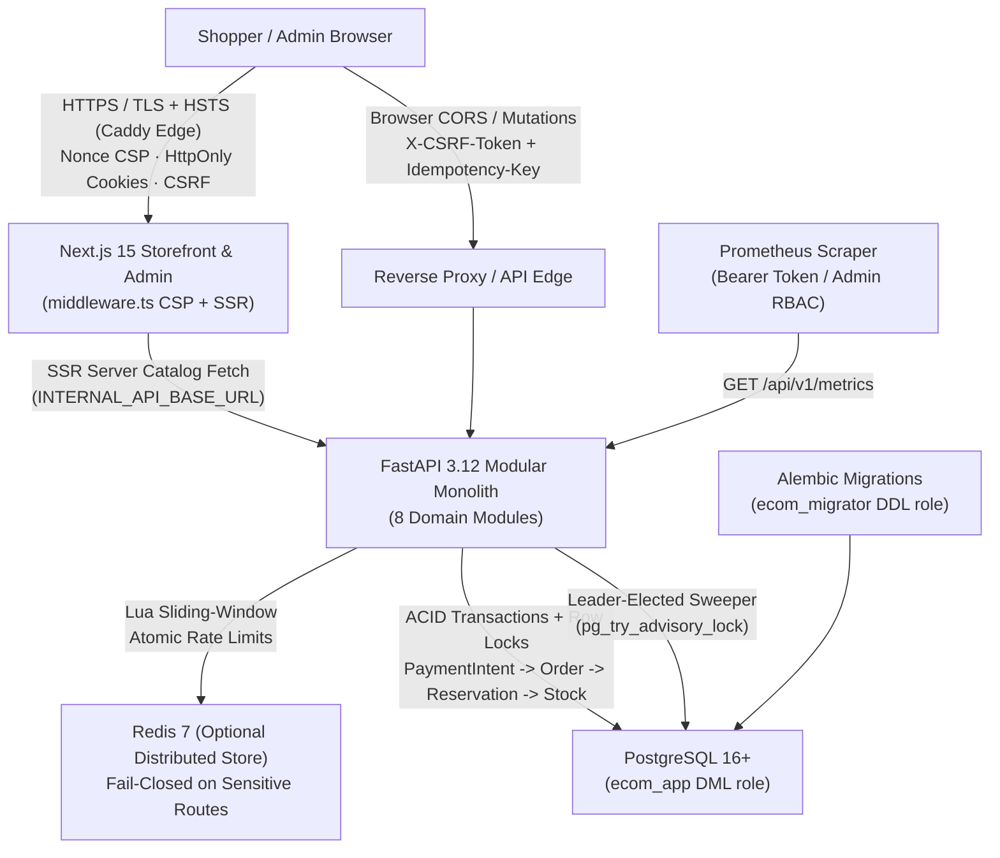
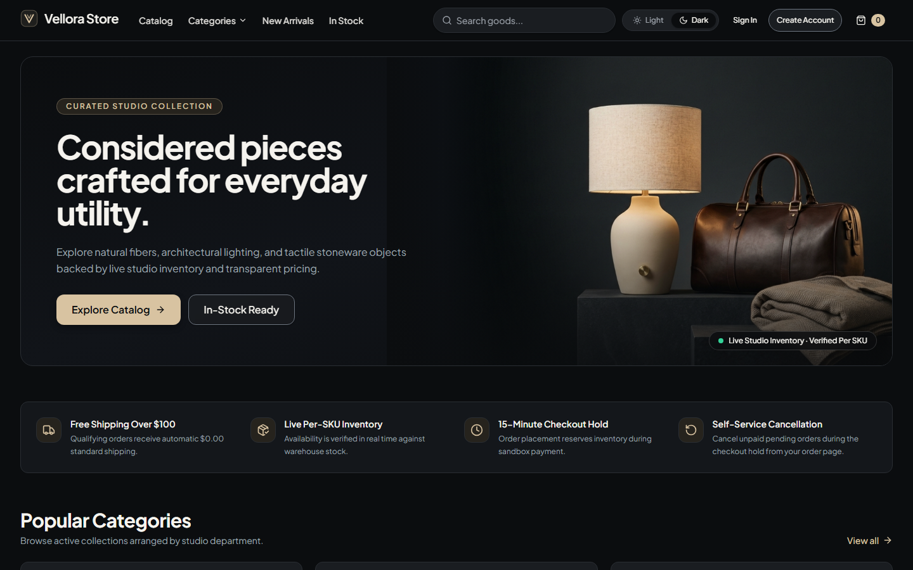
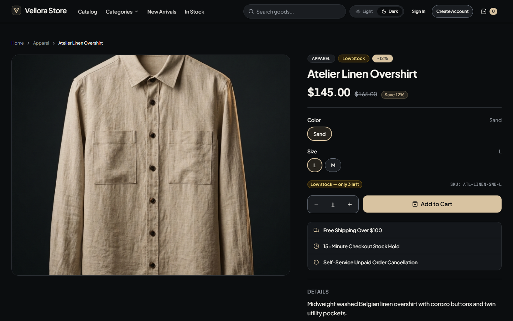
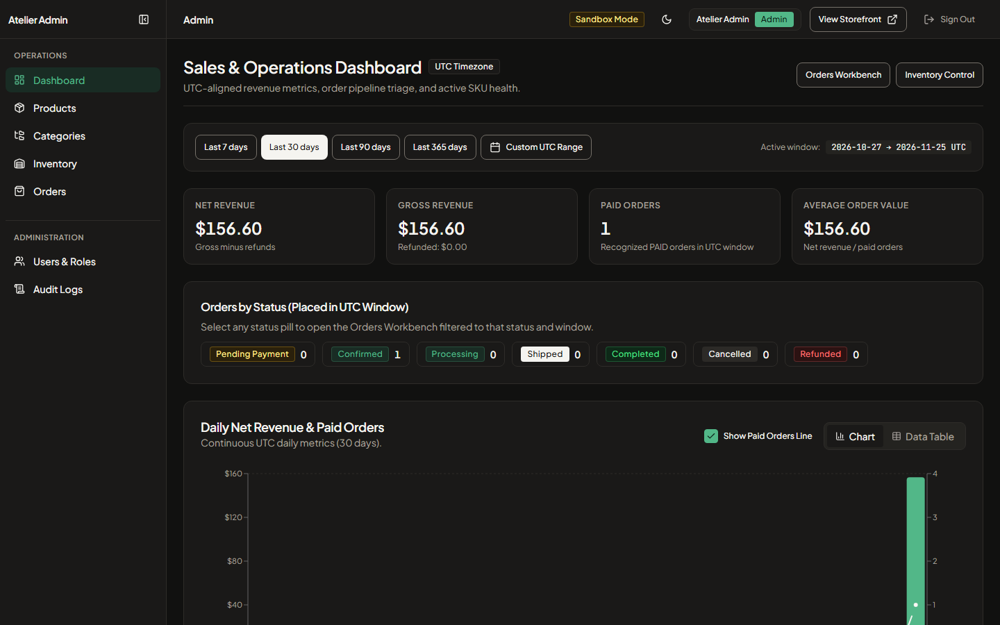

# Atelier Commerce — Production-Oriented Full-Stack E-Commerce Platform

> **Vellora Store** storefront and operations console built as a hardened, single-tenant **modular monolith** with **Next.js 15 / React 19 / TypeScript** and **Python 3.12 / FastAPI / SQLAlchemy 2 / PostgreSQL 16 / Alembic**.

> [!IMPORTANT]
> **Pre-Production & Payment Simulation Scope**: This platform operates with the in-process **SimPay sandbox payment adapter** (`PAYMENT_SANDBOX_MODE=true`) and stores zero payment card data. Production startup (`ENVIRONMENT=production`) fails closed unless a live production-ready payment provider adapter is registered and edge TLS/reverse-proxy prerequisites in [DEPLOYMENT-RUNBOOK.md](docs/ops/DEPLOYMENT-RUNBOOK.md) are provisioned. Do not describe or deploy it as PCI-certified without completing live PSP integration and infrastructure compliance checks.

---

## Architecture Overview



---

## Storefront & Admin Previews

Captured from the live running application (Next.js standalone server + FastAPI + PostgreSQL 18.6):

### Vellora Store — Dark-First Storefront Home


### Product Detail Page — Per-SKU Stock & Sticky Buy Box


### Admin Console — Sales Analytics & Operational Dashboard


---

## Core Business Features

- **Storefront & Catalog**: Server-rendered landing page (`/`), filterable catalog (`/products`), dynamic SEO metadata, real HTTP `404` product handling, mobile horizontal scroll-snap category rail, and accessible light/dark gallery theme toggle.
- **Per-SKU Inventory & Anti-Overselling**: Variant stock rows (`on_hand`, `reserved`) protected by PostgreSQL `CHECK (reserved <= on_hand)`, deterministic ascending lock ordering (`ORDER BY variant_id ASC FOR UPDATE`), 15-minute checkout reservations, append-only inventory ledger entries, and leader-elected background reservation reclamation.
- **Checkout & Provider-Agnostic Payments**: Server-computed prices/shipping/tax, `Idempotency-Key` request fingerprinting with `pg_advisory_xact_lock`, `PaymentProviderAdapter` / `PaymentProviderRegistry` abstraction (with default `SandboxSimpayAdapter`), strict 6-step HMAC-SHA256 webhook signature & replay verification, idempotent webhook deduplication, and self-service unpaid order cancellation.
- **Customer & Guest Access**: Argon2id accounts, server-backed `HttpOnly` sessions, `HttpOnly` signed guest order tokens (`ecom_guest_orders`), and PostgreSQL-enforced concurrent pending guest order limits (`<= 3`).
- **Admin Console (`staff` & `admin` RBAC)**: UTC sales analytics charts (`Recharts` + keyboard-accessible Data Table parity), catalog/variant management, manual stock adjustments, order fulfillment lifecycle, 3-phase admin refunds with restock, user role/session revocation with last-admin guards, and secret-redacted before/after JSON audit diffs.
- **Observability**: Secret-redacting JSON logs (`request_id`), `/api/v1/health`, `/api/v1/health/live`, `/api/v1/health/ready`, and admin/bearer-protected `/api/v1/metrics` in Prometheus exposition format.

---

## Technology Stack

| Layer | Technologies |
| :--- | :--- |
| **Frontend** | Next.js 15 (App Router, `standalone`, `middleware.ts`), React 19, TypeScript, Tailwind CSS, Recharts |
| **Backend API** | Python 3.12+, FastAPI, SQLAlchemy 2.0, Alembic, Pydantic Settings, Argon2id (`argon2-cffi`), Prometheus Client |
| **Data & Coordination** | PostgreSQL 16+ (primary transactional store), Redis 7+ (optional distributed Lua sliding-window rate limiter) |
| **Infrastructure & CI** | Docker Compose (`compose.yaml`, `compose.prod.yaml`), Caddy TLS proxy, GitHub Actions (Gitleaks, Trivy, Ruff, Mypy, Pytest + PG 16, Vitest, Playwright E2E) |
| **Verification** | Pytest + disposable PostgreSQL cluster, `fakeredis` Lua, Vitest (`jsdom`), Playwright Chromium, Locust (`2.47+`) |

---

## Quickstart (Linux, macOS, Windows)

### Prerequisites
- Docker Engine & Docker Compose v2 (for containerized quickstart), **or** Python 3.12+, Node.js 22+, and PostgreSQL 16+ (for native local execution).

### Option A — Docker Compose (Coexists Safely with Local PostgreSQL on Port `5432`)

`compose.yaml` binds PostgreSQL to host port `5433` (`POSTGRES_HOST_PORT:-5433`) on `127.0.0.1` by default so it does not collide with an existing local PostgreSQL instance on `5432`.

1. Copy the environment template (never commit `.env`):
   ```bash
   cp .env.example .env
   ```
   On Windows PowerShell:
   ```powershell
   Copy-Item .env.example .env
   ```

2. Generate random secrets (`>= 32` characters) and replace all `CHANGE_ME_DEV_ONLY_*` placeholders in `.env`:
   ```bash
   python3 -c "import secrets; print('POSTGRES_PASSWORD=' + secrets.token_urlsafe(24)); print('CSRF_HMAC_SECRET=' + secrets.token_urlsafe(32)); print('GUEST_ORDER_HMAC_SECRET=' + secrets.token_urlsafe(32)); print('PAYMENT_WEBHOOK_SECRET=' + secrets.token_urlsafe(32))"
   ```
   Ensure the password inside `DATABASE_URL` matches `POSTGRES_PASSWORD`. To enable the optional Redis rate-limiter container, set `REDIS_URL=redis://redis:6379/0` in `.env` and pass `--profile redis`.

3. Build and start the stack:
   ```bash
   docker compose up -d --build
   # Optional: include local Redis container for distributed rate limiting
   docker compose --profile redis up -d --build
   ```

4. Seed the demo catalog (`3` categories, `8` products, `11` variants) and demo accounts (`development` / `test` only — refuses `ENVIRONMENT=production`):
   ```bash
   docker compose exec api python -m app.cli seed-demo --with-demo-users
   ```

5. Access locally:
   - **Storefront**: `http://localhost:3000`
   - **Admin Console**: `http://localhost:3000/admin` (sign in at `/login`)
   - **API Health**: `http://localhost:8000/api/v1/health` (`live` / `ready` / `metrics`)
   - **OpenAPI / Docs** (`development` only): `http://localhost:8000/api/v1/docs`

*(Default demo accounts created by `--with-demo-users` in local dev: `customer@atelier.example` / `AtelierCustomer!2026`, `staff@atelier.example` / `AtelierStaff!2026`, `admin@atelier.example` / `AtelierAdmin!2026` — override via `DEMO_*_PASSWORD` env vars outside ephemeral local testing.)*

### Option B — Native Local Development

1. **Database**: Provision a local PostgreSQL 16+ database (outside port `5432` if another cluster runs there) and export `DATABASE_URL` plus strong 32+-character `CSRF_HMAC_SECRET`, `GUEST_ORDER_HMAC_SECRET`, and `PAYMENT_WEBHOOK_SECRET`.
2. **Backend (`backend/`)**:
   ```bash
   cd backend
   python3 -m venv .venv
   # Activate: source .venv/bin/activate (Linux/macOS) or .venv\Scripts\Activate.ps1 (Windows)
   pip install -e ".[dev]"
   alembic upgrade head
   python -m app.cli seed-demo --with-demo-users
   uvicorn app.main:app --host 127.0.0.1 --port 8000
   ```
3. **Frontend (`frontend/`)**:
   ```bash
   cd frontend
   npm ci
   NEXT_PUBLIC_API_BASE_URL=http://localhost:8000/api/v1 npm run build
   npm run start
   ```
   *(On Windows PowerShell where `npm.ps1` may be restricted by ExecutionPolicy, use `npm.cmd` and `npx.cmd`.)*

---

## Testing & Benchmarking

### Backend Lint, Typecheck & Live PostgreSQL Suite
```bash
cd backend
ruff check .
mypy app tests/run_disposable_pg_pytest.py tests/test_admin_and_analytics.py
alembic heads
pytest -v

# On Windows with local PG binaries, run isolated disposable PostgreSQL tests:
python tests/run_disposable_pg_pytest.py
```

### Frontend Lint, Typecheck, Unit Tests & Full-Stack Playwright E2E
```bash
cd frontend
npm run lint
npx tsc --noEmit
npm test
npm run build
npx playwright test

# On Windows, use the isolated Windows runner (auto-picks free ports if 3000/8000 are busy):
python e2e/run_e2e_stack.py --auto-ports
```

### Reproducible Load Testing (Locust — 10, 50, 100 VUs)
```bash
cd backend
python tests/load/run_load_suite.py
```
Runs headless Locust tiers (`10`, `50`, and `100` concurrent VUs) against an isolated disposable PostgreSQL cluster and verifies post-load database stock/order invariants (`reserved >= 0`, `reserved <= on_hand`, `SUM(active reservations) == reserved`, zero multi-capture orders). See [LOAD-TEST-REPORT.md](docs/qa/LOAD-TEST-REPORT.md) for measured throughput and single-worker Argon2id findings.

---

## Security Architecture

- **Authentication & CSRF**: `Argon2id` (`64 MiB`, `t=3`, `p=1`) password hashing with dummy-hash timing mitigation; 256-bit `HttpOnly`, `SameSite=Lax` cookies backed by hashed DB sessions; strict `Origin`/`Referer`/`Sec-Fetch-Site` + session-bound HMAC `X-CSRF-Token` validation on mutations.
- **Content Security Policy**: Production HTML responses receive a fresh per-request 128-bit cryptographic nonce (`script-src 'self' 'nonce-...'`) generated in [middleware.ts](frontend/src/middleware.ts) and consumed via async `RootLayout` SSR; `style-src 'self' 'unsafe-inline'` is explicitly retained for Recharts SVG styling and Radix UI portals.
- **Distributed Rate Limiting**: Optional atomic Redis Lua sliding-window limiter with bounded key `PTTL` and fail-closed `503 RATE_LIMITER_UNAVAILABLE` protection on auth, checkout, payment, and guest order routes (`fail_closed_sensitive`).
- **Secrets, Supply Chain & Observability**: Hash-pinned `backend/requirements.lock`, `gitleaks` CI secret scanning, Trivy container CVE scanning in CI, constant-time bearer/admin RBAC protection on `/api/v1/metrics`, and recursive secret redaction in structured JSON logs.

---

## Known Limitations & Future Extensions

- **Architecture Scope (Single-Tenant)**: Currently designed as a single-tenant storefront and admin platform; multi-tenancy, tenant isolation (`tenant_id`), and recurring SaaS subscription billing are intentionally out of scope and planned as future extensions.
- **Sandbox Payments Only**: Default runtime ships with `SandboxSimpayAdapter`; integrating Stripe/Adyen requires implementing a production `PaymentProviderAdapter`, mapping verified provider webhooks, replacing local sandbox simulation routes, and completing external PCI/merchant onboarding.
- **Single-Currency & Baseline Shipping/Tax**: Pricing, carts, and orders operate in `USD` integer minor units (`*_cents`) with server-configured flat/threshold shipping and `TAX_RATE_BPS` rules.
- **Horizontal Scaling Considerations**: Under sustained concurrent logins (`50–100+` VUs), CPU-intensive Argon2id verification benefits from running multiple API worker processes backed by external PostgreSQL pooling (`PgBouncer`) and Redis.

---

## Documentation Index

- **Production Hardening Plan**: [docs/audits/PRODUCTION-HARDENING-PLAN.md](docs/audits/PRODUCTION-HARDENING-PLAN.md)
- **Production Hardening Final Report**: [docs/audits/PRODUCTION-HARDENING-REPORT.md](docs/audits/PRODUCTION-HARDENING-REPORT.md)
- **Secret & Dependency Scan Report**: [docs/security/SECRET-SCAN-REPORT.md](docs/security/SECRET-SCAN-REPORT.md)
- **QA Regression Report**: [docs/qa/REGRESSION-REPORT.md](docs/qa/REGRESSION-REPORT.md)
- **Locust Load Test Report**: [docs/qa/LOAD-TEST-REPORT.md](docs/qa/LOAD-TEST-REPORT.md)
- **Deployment & Backup/Restore Runbook**: [docs/ops/DEPLOYMENT-RUNBOOK.md](docs/ops/DEPLOYMENT-RUNBOOK.md)
- **Architecture & ADRs**: [docs/architecture/01-system-overview-and-modules.md](docs/architecture/01-system-overview-and-modules.md), [04-adrs-and-roadmap.md](docs/architecture/04-adrs-and-roadmap.md)
