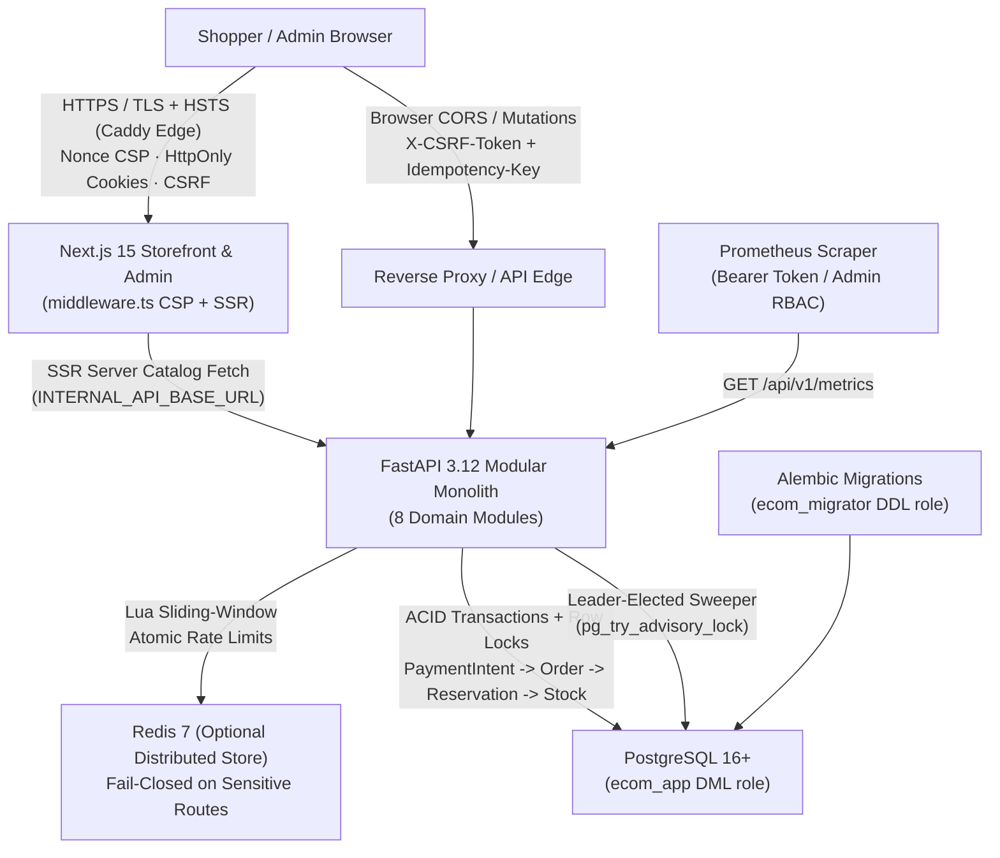

[English](README.md) | [Русский](README.ru.md)

# Atelier Commerce — Full-Stack E-Commerce Platform (`v1.0.0`)

> **Vellora Store** storefront and **Atelier Admin** operations console engineered as a single-tenant **modular monolith** using **Next.js 15 / React 19 / TypeScript** and **Python 3.12 / FastAPI / SQLAlchemy 2 / PostgreSQL 16+ / Alembic**.

> [!IMPORTANT]
> **Engineering Portfolio Scope & Payment Simulation Notice**: Release `v1.0.0` is an engineering portfolio release running with the in-process **SimPay sandbox payment adapter** (`PAYMENT_PROVIDER=sandbox_simpay`, `PAYMENT_SANDBOX_MODE=true`) and stores zero payment card data. Startup with `ENVIRONMENT=production` fails closed unless a live production-ready payment provider adapter is registered and the TLS/reverse-proxy prerequisites in [DEPLOYMENT-RUNBOOK.md](docs/ops/DEPLOYMENT-RUNBOOK.md) are provisioned. Do **not** deploy or describe this release as live-commerce or PCI-certified without completing real PSP integration and compliance audits.

---

## Live Full-Flow Demo

Recorded end-to-end against the live running application (`Next.js 15` standalone + `FastAPI` + isolated `PostgreSQL`):


[Watch full-resolution 1440×900 MP4 demo](docs/assets/demo/full-flow.mp4)

**Walkthrough captured in the demo (`38.2s`):**
1. **Storefront (`/`)**: Editorial dark-first hero with server-rendered featured collections and live inventory indicators.
2. **Product Catalog (`/products`)**: Browse studio items and open `Atelier Linen Overshirt`.
3. **Variant & Size Selection (`/products/linen-overshirt`)**: Interactive SKU radiogroups (`Sand / L` → `Sand / M`, SKU `ATL-LINEN-SND-M`, live `24` in stock).
4. **Shopping Bag & Checkout (`/cart` → `/checkout`)**: Add item to cart, review server-reconciled subtotal and complimentary shipping, and place an order with synthetic non-PII demo details (`guest@example.com`).
5. **Sandbox Payment & Confirmation (`/orders/ORD-...`)**: Execute `Simulate Payment Success` (`Sandbox SimPay`) to transition order `ORD-20261125-QVKTHYC2` to **Confirmed / Paid**.
6. **Admin Console & Inventory Verification (`/admin` → `/admin/orders` → `/admin/inventory`)**: Inspect live KPI analytics, view the newly paid order, and verify `ATL-LINEN-SND-M` stock atomically decremented from `24` to `23`.

---

## Storefront & Admin Previews

### Vellora Store — Dark-First Storefront Home


### Product Detail Page — Per-SKU Stock & Sticky Buy Box


### Admin Console — Sales Analytics & Operational Dashboard


---

## Architecture & Technology Stack



| Layer | Technologies |
| :--- | :--- |
| **Frontend** | Next.js 15 (App Router, `standalone`, `middleware.ts`), React 19, TypeScript, Tailwind CSS, Recharts |
| **Backend API** | Python 3.12+, FastAPI, SQLAlchemy 2.0, Alembic, Pydantic Settings, Argon2id (`argon2-cffi`), Prometheus Client |
| **Data & Coordination** | PostgreSQL 16+ (primary transactional store), Redis 7+ (optional distributed Lua sliding-window rate limiter) |
| **Infrastructure & CI** | Docker Compose (`compose.yaml`, `compose.prod.yaml`), Caddy TLS proxy, GitHub Actions (`gitleaks`, Trivy, Ruff, Mypy, Pytest + PG 16, Vitest, Playwright E2E) |
| **Verification** | Pytest + disposable PostgreSQL cluster, `fakeredis` Lua, Vitest (`jsdom`), Playwright Chromium, Locust (`2.47+`) |

---

## Core Storefront & Admin Features

- **Storefront & Catalog**: Server-rendered landing page (`/`), filterable catalog (`/products`), dynamic SEO metadata, real HTTP `404` product handling, mobile horizontal scroll-snap category rail, and accessible light/dark gallery theme toggle.
- **Per-SKU Inventory & Anti-Overselling**: Variant stock rows (`on_hand`, `reserved`) protected by PostgreSQL `CHECK (reserved <= on_hand)`, deterministic ascending lock ordering (`ORDER BY variant_id ASC FOR UPDATE`), 15-minute checkout reservations, append-only inventory ledger entries, and leader-elected background reservation reclamation (`pg_try_advisory_lock`).
- **Checkout & Provider-Agnostic Payments**: Server-computed prices/shipping/tax (`USD` minor units), `Idempotency-Key` request fingerprinting with `pg_advisory_xact_lock`, `PaymentProviderAdapter` / `PaymentProviderRegistry` abstraction (defaulting to `SandboxSimpayAdapter`), strict 6-step HMAC-SHA256 webhook signature & replay verification, idempotent webhook deduplication, and self-service unpaid order cancellation.
- **Customer & Guest Access**: `Argon2id` accounts, server-backed `HttpOnly` sessions, `HttpOnly` signed guest order tokens (`ecom_guest_orders`), and PostgreSQL-enforced concurrent pending guest order limits (`<= 3`).
- **Admin Console (`staff` & `admin` RBAC)**: UTC sales analytics charts (`Recharts` + keyboard-accessible data table parity), catalog/variant management, manual stock adjustments, order fulfillment lifecycle, 3-phase admin refunds with restock, user role/session revocation with last-admin guards, and secret-redacted before/after JSON audit diffs.
- **Observability**: Secret-redacting JSON logs (`request_id`), `/api/v1/health`, `/api/v1/health/live`, `/api/v1/health/ready`, and admin/bearer-protected `/api/v1/metrics` in Prometheus exposition format.

---

## Quickstart (Linux, macOS, Windows)

### Prerequisites
- Docker Engine & Docker Compose v2 (for containerized quickstart), **or** Python 3.12+, Node.js 22+, and PostgreSQL 16+ (for native local development).

### Option A — Docker Compose (Safe Coexistence with Local PostgreSQL on `5432`)

`compose.yaml` binds PostgreSQL to host port `5433` (`POSTGRES_HOST_PORT=5433`) on `127.0.0.1` by default so it does not collide with an existing local PostgreSQL cluster on `5432`.

1. Copy the environment template (never commit `.env`):
   ```bash
   cp .env.example .env
   ```
   On Windows PowerShell:
   ```powershell
   Copy-Item .env.example .env
   ```

2. Generate random secrets (`>= 32` characters) and replace all `CHANGE_ME_DEV_ONLY_*` placeholders in `.env`:
   ```bash
   python3 -c "import secrets; print('POSTGRES_PASSWORD=' + secrets.token_urlsafe(24)); print('CSRF_HMAC_SECRET=' + secrets.token_urlsafe(32)); print('GUEST_ORDER_HMAC_SECRET=' + secrets.token_urlsafe(32)); print('PAYMENT_WEBHOOK_SECRET=' + secrets.token_urlsafe(32))"
   ```
   Ensure the password inside `DATABASE_URL` matches `POSTGRES_PASSWORD`. To enable the optional Redis rate-limiter container, set `REDIS_URL=redis://redis:6379/0` in `.env` and pass `--profile redis`.

3. Build and start the stack:
   ```bash
   docker compose up -d --build
   # Optional: include local Redis container for distributed rate limiting
   docker compose --profile redis up -d --build
   ```

4. Seed the demo catalog (`3` categories, `8` products, `11` variants) and demo accounts (`development` / `test` only — refuses `ENVIRONMENT=production`):
   ```bash
   docker compose exec api python -m app.cli seed-demo --with-demo-users
   ```

5. Local endpoints:
   - **Storefront**: `http://localhost:3000`
   - **Admin Console**: `http://localhost:3000/admin` (sign in at `/login`)
   - **API Health & Metrics**: `http://localhost:8000/api/v1/health` (`live` / `ready` / `metrics`)
   - **OpenAPI / Swagger** (`development` only): `http://localhost:8000/api/v1/docs`

*(Default dev demo accounts created by `--with-demo-users`: `customer@atelier.example` / `AtelierCustomer!2026`, `staff@atelier.example` / `AtelierStaff!2026`, `admin@atelier.example` / `AtelierAdmin!2026` — override via `DEMO_*_PASSWORD` env vars outside ephemeral local testing.)*

### Option B — Native Local Development

1. **Database**: Provision a local PostgreSQL 16+ database and export `DATABASE_URL` plus strong 32+-character `CSRF_HMAC_SECRET`, `GUEST_ORDER_HMAC_SECRET`, and `PAYMENT_WEBHOOK_SECRET`.
2. **Backend (`backend/`)**:
   ```bash
   cd backend
   python3 -m venv .venv
   # Activate: source .venv/bin/activate (Linux/macOS) or .venv\Scripts\Activate.ps1 (Windows)
   pip install -e ".[dev]"
   alembic upgrade head
   python -m app.cli seed-demo --with-demo-users
   uvicorn app.main:app --host 127.0.0.1 --port 8000
   ```
3. **Frontend (`frontend/`)**:
   ```bash
   cd frontend
   npm ci
   NEXT_PUBLIC_API_BASE_URL=http://localhost:8000/api/v1 npm run build
   npm run start
   ```
   *(On Windows PowerShell where `npm.ps1` is blocked by ExecutionPolicy, use `npm.cmd` and `npx.cmd`.)*

---

## Environment Configuration

Key variables defined in [`.env.example`](.env.example):

| Variable | Default (`.env.example`) | Purpose & Production Rules |
| :--- | :--- | :--- |
| `POSTGRES_HOST_PORT` / `API_HOST_PORT` / `WEB_HOST_PORT` / `REDIS_HOST_PORT` | `5433` / `8000` / `3000` / `6379` | Loopback host port bindings in `compose.yaml` (avoids colliding with local PG on `5432`). |
| `DATABASE_URL` | `postgresql+psycopg://ecom_dev:...@db:5432/ecom_dev` | Primary SQLAlchemy connection string (uses least-privilege `ecom_app` DML role in `compose.prod.yaml`). |
| `MIGRATION_DATABASE_URL` | *(empty)* | Optional dedicated DDL owner URL (`ecom_migrator`) used strictly by `migrate` / `alembic`. |
| `ENVIRONMENT` | `development` | `development` \| `test` \| `staging` \| `production`. Enables strict fail-closed boot checks in `production`. |
| `COOKIE_SECURE` | `false` | Must be `true` behind HTTPS in `staging`/`production`. |
| `ALLOWED_ORIGINS` | `http://localhost:3000` | Explicit comma-separated origins; wildcards (`*`) or missing values fail closed in `production`. |
| `TRUSTED_PROXY_IPS` | *(empty)* | Comma-separated reverse-proxy IPs/CIDRs trusted for `X-Forwarded-For` client IP resolution. |
| `CSRF_HMAC_SECRET`, `GUEST_ORDER_HMAC_SECRET`, `PAYMENT_WEBHOOK_SECRET` | `CHANGE_ME_DEV_ONLY_...` | Separate `>= 32`-character cryptographic secrets; placeholders or short keys fail closed on startup. |
| `PAYMENT_PROVIDER`, `PAYMENT_SANDBOX_MODE` | `sandbox_simpay`, `true` | `ENVIRONMENT=production` fails closed whenever `PAYMENT_SANDBOX_MODE=true` or `sandbox_simpay` is active. |
| `SESSION_TTL_HOURS`, `RESERVATION_SWEEPER_INTERVAL_SECONDS` | `168`, `60` | Server-backed session lifetime (`7` days) and leader-elected expired-reservation sweep cadence (`0` disables). |
| `REDIS_URL`, `RATE_LIMIT_KEY_PREFIX`, `RATE_LIMIT_FAILURE_MODE` | *(empty)*, `atelier:rl`, `fail_closed_sensitive` | Distributed Lua sliding-window limiter (`fail_closed_sensitive` returns `503` on sensitive endpoints if Redis is unavailable). |
| `LOG_FORMAT`, `METRICS_ENABLED`, `METRICS_BEARER_TOKEN` | `json`, `true`, *(empty)* | Structured log format (`json`\|`text`) and optional `>= 32`-char scraper bearer token for `/api/v1/metrics`. |
| `FREE_SHIPPING_THRESHOLD_CENTS`, `STANDARD_SHIPPING_CENTS`, `TAX_RATE_BPS` | `10000`, `1000`, `800` | Server-authoritative baseline pricing rules (`$100.00` free-shipping threshold, `$10.00` shipping, `8.00%` tax). |
| `NEXT_PUBLIC_API_BASE_URL`, `NEXT_PUBLIC_SITE_URL`, `INTERNAL_API_BASE_URL` | `http://localhost:8000/api/v1`, `http://localhost:3000`, `http://api:8000/api/v1` | Browser API URL (build-time arg), canonical metadata origin (`https://` in prod), and SSR internal Docker URL. |

---

## Security Mechanisms

- **Authentication & CSRF**: `Argon2id` (`64 MiB`, `t=3`, `p=1`) password hashing with dummy-hash timing mitigation; 256-bit `HttpOnly`, `SameSite=Lax` cookies backed by hashed DB sessions; strict `Origin`/`Referer`/`Sec-Fetch-Site` + session-bound HMAC `X-CSRF-Token` validation on mutations.
- **Content Security Policy**: Production HTML responses receive a fresh per-request 128-bit cryptographic nonce (`script-src 'self' 'nonce-...'`) generated in [`middleware.ts`](frontend/src/middleware.ts) and consumed via async `RootLayout` SSR; `style-src 'self' 'unsafe-inline'` is explicitly retained for Recharts SVG styling and Radix UI portals.
- **Distributed Rate Limiting**: Optional atomic Redis Lua sliding-window limiter with bounded key `PTTL` and fail-closed `503 RATE_LIMITER_UNAVAILABLE` protection on auth, checkout, payment, and guest order routes (`fail_closed_sensitive`).
- **Secrets, Supply Chain & Observability**: Hash-pinned [`backend/requirements.lock`](backend/requirements.lock), `gitleaks` CI secret scanning, Trivy container CVE scanning in CI, constant-time bearer/admin RBAC protection on `/api/v1/metrics`, and recursive secret redaction in structured JSON logs.

---

## Automated Testing Results

Verified across the `v1.0.0` release baseline (post-merge CI run `45690392115`: `6/6` GitHub Actions jobs green — `detect`, `secret-scan`, `ops-validate`, `backend-ci`, `frontend-ci`, `e2e-ci`) and local container integration runs:

| Suite / Check | Environment | Result | Notes |
| :--- | :--- | :--- | :--- |
| **Backend Integration & Unit (`pytest -v`)** | `postgres:16-alpine` (`16.16`) + `redis:7-alpine` (`7.4.12`) | **227 passed, 0 skipped, 0 failed** (`89.83s`) | Covers auth, RBAC, CSRF, concurrency, Lua rate limiting, migrations, webhooks, fail-closed boot. |
| **Frontend Unit & Component (`vitest`)** | Node 22 + `jsdom` | **95 passed across 6 files** (`0` failed) | Storefront SSR, admin console, checkout flows, API client, formatters & security helpers. |
| **Full-Stack Browser E2E (`playwright`)** | Live Next.js standalone + FastAPI + disposable PG 18.6 | **6 passed** (`39.9s`, `0` console/CSP errors) | End-to-end storefront, cart, checkout, payment simulation, guest orders, and admin workflows. |
| **Static Analysis & Dependency Audits** | `ruff`, `mypy`, `pip-audit`, `npm audit`, `gitleaks` | **0 lint / type / CVE / secret findings** | `mypy` clean across `70` files; `gitleaks` clean across full Git history. |

### Commands to Reproduce Locally
```bash
# Backend lint, types, migrations, and isolated disposable PostgreSQL suite
cd backend
ruff check .
mypy app tests/run_disposable_pg_pytest.py tests/test_admin_and_analytics.py
alembic heads
pytest -v                               # Linux/Docker against PostgreSQL + Redis
python tests/run_disposable_pg_pytest.py  # Windows isolated disposable cluster

# Frontend lint, types, unit tests, build, and Playwright E2E
cd ../frontend
npm run lint
npx tsc --noEmit
npm test
npm run build
npx playwright test                     # or: python e2e/run_e2e_stack.py --auto-ports
```

---

## Performance Benchmarks

Measured with headless **Locust `2.47+`** across worker-scaling and sustained transactional workloads (details in [LOAD-TEST-REPORT.md](docs/qa/LOAD-TEST-REPORT.md)):

| Scenario | Concurrency & Duration | Throughput & Latency | Errors & Business Invariants |
| :--- | :--- | :--- | :--- |
| **1 / 2 / 4 Worker Scaling** (`PG 16.16` + `Redis 7.4.12`) | `50` VUs, `20s` per run | `1w`: `79.26–82.66` RPS (`390–440 ms` p50)<br>`2w`: `126.89–127.62` RPS (`180–190 ms` p50)<br>`4w`: `165.81` RPS (`61 ms` p50, `290 ms` p95) | `0%` `5xx`; rapid `r=25/s` burst saturates Argon2id CPU at `72.69` RPS. |
| **Sustained Realistic Pacing** (`4` workers, disposable PG) | `50` VUs (`0.8–1.4s` wait), `60s` | **4,640 requests · 78.34 RPS**<br>p50 `16.0 ms` · p95 `130.0 ms` · p99 `450.0 ms` | **0.00% errors**, `540.63 MiB` avg / `789.01 MiB` peak API RAM, `23.87` avg / `25` peak DB conns, `604/604` paid orders, `5/5` scarcity SKU (`0` oversell). |
| **Unthrottled Docker Burst** (`PG 16.16` + `Redis 7.4.12`) | `40` VUs, `60s` | **9,528 requests · 160.65 RPS**<br>p50 `32.0 ms` · p95 `200.0 ms` | `0` `5xx` errors (`338` expected `429` rate-limiter rejections). |

---

## Production Hardening

Operational hardening verified across Docker, PostgreSQL, Redis, and Caddy (full evidence in [PRODUCTION-HARDENING-REPORT.md](docs/audits/PRODUCTION-HARDENING-REPORT.md)):

- **Least-Privilege PostgreSQL Roles**: [`infra/postgres/init-roles.sql`](infra/postgres/init-roles.sql) separates schema migrations (`ecom_migrator` DDL owner) from runtime API execution (`ecom_app` DML-only role with zero DDL privileges); verified through Alembic revision `0003`.
- **Hardened Non-Root Containers & Trivy Scans**: [`infra/docker/backend.Dockerfile`](infra/docker/backend.Dockerfile) (`343 MB`) and [`infra/docker/frontend.Dockerfile`](infra/docker/frontend.Dockerfile) (`382 MB`) strip runtime package managers (`pip`, `ensurepip`, `npm`, `corepack`), run as non-root with `read_only` root filesystems in [`compose.prod.yaml`](compose.prod.yaml), and pass `trivy image --severity CRITICAL,HIGH --ignore-unfixed --exit-code 1` (`0` Python, `0` Node.js, `0` Alpine OS, `0` fixable Debian CVEs; `13` unique / `53` occurrence upstream unfixed Debian `13.8` advisories documented).
- **Reverse-Proxy Edge Isolation**: [`infra/caddy/Caddyfile`](infra/caddy/Caddyfile) terminates TLS with strict HSTS, forwards nonce CSP headers, and blocks external access to `/api/v1/metrics` (`HTTP 404` at the edge).
- **Resilience & Fail-Closed Boot**: Tested live Redis and PostgreSQL container outages (`api` auto-recovered with `0` container restarts; sensitive routes cleanly returned `503 RATE_LIMITER_UNAVAILABLE` during Redis downtime). Setting `ENVIRONMENT=production` with `sandbox_simpay` / `PAYMENT_SANDBOX_MODE=true` aborts startup (`exit 3`).

---

## Known Limitations

- **Single-Tenant Scope**: Architected as a single-tenant storefront and admin platform; multi-tenancy (`tenant_id` isolation) and recurring SaaS billing are deferred to future phases.
- **Sandbox Payment Provider Only**: Default runtime ships with `SandboxSimpayAdapter`; live commerce requires implementing a production `PaymentProviderAdapter`, configuring real PSP webhooks, and completing external merchant/PCI compliance checks.
- **Single Currency & Flat Tax/Shipping Rules**: Carts and orders operate in `USD` minor units (`*_cents`) with server-configured flat/threshold shipping and `TAX_RATE_BPS`.
- **Argon2id CPU Scaling**: Under heavy concurrent login bursts (`50–100+` VUs), CPU-bound Argon2id verification benefits from running multiple API worker processes behind external PostgreSQL connection pooling (`PgBouncer`) and Redis.

---

## Repository Structure & Documentation Index

```text
.
├── .github/workflows/ci.yml        # 6-job CI pipeline (Gitleaks, Ops/Trivy, Ruff/Mypy/Pytest, Vitest, E2E)
├── backend/
│   ├── alembic/                    # Migrations (0001..0003) & env.py
│   ├── app/
│   │   ├── core/                   # Config, DB session, Argon2id security, Redis rate limit, audit, logging
│   │   ├── models/                 # SQLAlchemy 2 ORM models
│   │   └── modules/                # 8 domain modules (auth, catalog, cart, orders, payments, inventory, admin, health)
│   └── tests/                      # 227 pytest integration/unit tests + Locust load suite
├── frontend/
│   ├── e2e/                        # Live full-stack Playwright E2E suite & Windows runner
│   ├── public/assets/              # Studio product imagery
│   ├── src/
│   │   ├── app/                    # Next.js 15 App Router routes ((storefront) & /admin)
│   │   ├── components/             # Storefront, checkout, and admin UI components
│   │   └── middleware.ts           # Per-request cryptographic nonce CSP generator
│   └── tests/                      # 95 Vitest component & unit tests
├── infra/
│   ├── caddy/Caddyfile             # TLS/HSTS edge config & /api/v1/metrics exposure block
│   ├── docker/                     # Multi-stage non-root backend & frontend Dockerfiles
│   └── postgres/init-roles.sql     # Least-privilege ecom_migrator / ecom_app DB role split
├── docs/
│   ├── api/                        # OpenAPI contracts & schema conventions
│   ├── architecture/               # System overview, ERD, concurrency workflows & ADRs
│   ├── assets/                     # Live full-flow demo GIF/MP4 & storefront/admin screenshots
│   ├── audits/                     # Production hardening plan & final release verification report
│   ├── ops/                        # Local dev setup, CI workflow, deployment & backup runbook
│   ├── qa/                         # Regression & Locust load-test reports
│   └── security/                   # Secret & dependency scan reports
├── compose.yaml                    # Local development stack (PG 16, optional --profile redis)
├── compose.prod.yaml               # Hardened production stack with Caddy, read_only containers & roles
└── .env.example                    # Documented environment template
```

- **Production Hardening Plan & Final Report**: [PRODUCTION-HARDENING-PLAN.md](docs/audits/PRODUCTION-HARDENING-PLAN.md) · [PRODUCTION-HARDENING-REPORT.md](docs/audits/PRODUCTION-HARDENING-REPORT.md)
- **Secret & Dependency Scan Report**: [SECRET-SCAN-REPORT.md](docs/security/SECRET-SCAN-REPORT.md)
- **QA Regression & Load Test Reports**: [REGRESSION-REPORT.md](docs/qa/REGRESSION-REPORT.md) · [LOAD-TEST-REPORT.md](docs/qa/LOAD-TEST-REPORT.md)
- **Deployment & Backup/Restore Runbook**: [DEPLOYMENT-RUNBOOK.md](docs/ops/DEPLOYMENT-RUNBOOK.md)
- **Architecture & ADRs**: [01-system-overview-and-modules.md](docs/architecture/01-system-overview-and-modules.md) · [04-adrs-and-roadmap.md](docs/architecture/04-adrs-and-roadmap.md)
