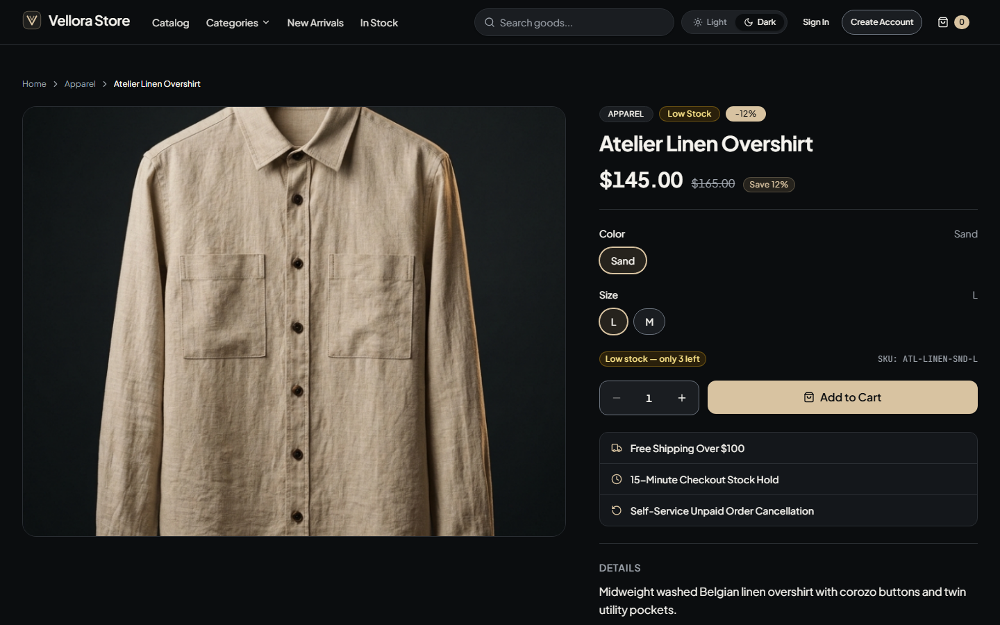
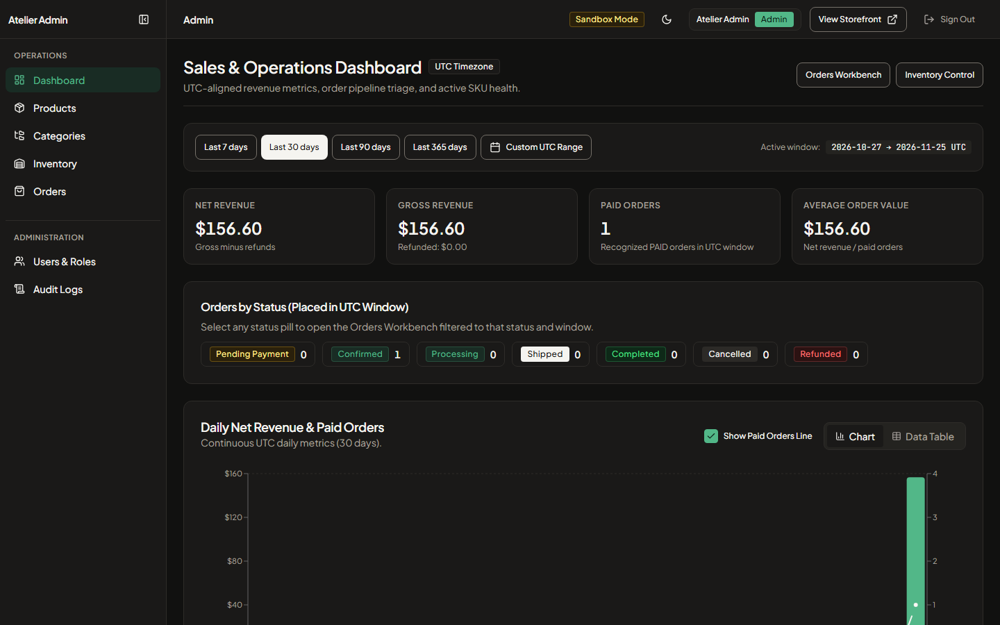
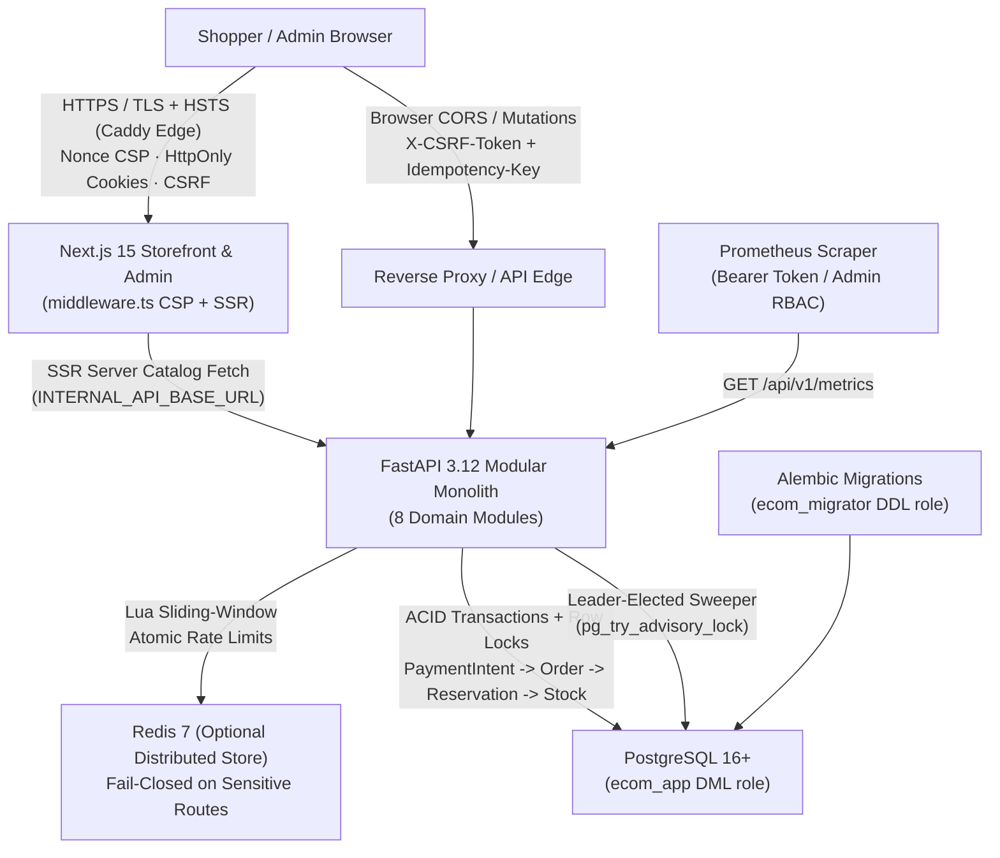

[English](README.md) | [Русский](README.ru.md)

# Atelier Commerce — Full-Stack E-Commerce Платформа (`v1.0.0`)

> Витрина **Vellora Store** и административная консоль **Atelier Admin**, реализованные в архитектуре однотенантного **модульного монолита** на базе **Next.js 15 / React 19 / TypeScript** и **Python 3.12 / FastAPI / SQLAlchemy 2 / PostgreSQL 16+ / Alembic**.

> [!IMPORTANT]
> **Область применения (портфолио-релиз) и симуляция оплаты**: Релиз `v1.0.0` представляет собой инженерный портфолио-проект, работающий со встроенным **тестовым платёжным адаптером SimPay** (`PAYMENT_PROVIDER=sandbox_simpay`, `PAYMENT_SANDBOX_MODE=true`), и не собирает и не хранит данные банковских карт. Запуск в режиме `ENVIRONMENT=production` принудительно блокируется (fail-closed) до регистрации боевого платёжного провайдера и выполнения требований к TLS и reverse proxy из [DEPLOYMENT-RUNBOOK.md](docs/ops/DEPLOYMENT-RUNBOOK.md). Не используйте и не позиционируйте данный релиз как готовый к коммерческой эксплуатации или сертифицированный по PCI DSS без интеграции реального PSP и прохождения аудита соответствия.

---

## Демонстрация полного пользовательского сценария

Записано в реальном времени на запущенном приложении (`Next.js 15` standalone + `FastAPI` + изолированный `PostgreSQL`):


[Смотреть видео в полном разрешении 1440×900 (MP4)](docs/assets/demo/full-flow.mp4)

**Этапы сценария на видео (`38.2 с`):**
1. **Витрина (`/`)**: Главная страница в тёмной теме с SSR-подборками и индикаторами актуальных складских остатков.
2. **Каталог товаров (`/products`)**: Просмотр каталога и переход на карточку `Atelier Linen Overshirt`.
3. **Выбор варианта и размера (`/products/linen-overshirt`)**: Переключение SKU через доступные группы опций (`Sand / L` → `Sand / M`, артикул `ATL-LINEN-SND-M`, остаток `24` шт.).
4. **Корзина и оформление заказа (`/cart` → `/checkout`)**: Добавление товара, проверка пересчитанного сервером итога с бесплатной доставкой и оформление заказа на синтетические демонстрационные данные (`guest@example.com`).
5. **Тестовая оплата и подтверждение (`/orders/ORD-...`)**: Нажатие `Simulate Payment Success` (`Sandbox SimPay`) переводит заказ `ORD-20261125-QVKTHYC2` в статус **Confirmed / Paid**.
6. **Административная панель и складской учёт (`/admin` → `/admin/orders` → `/admin/inventory`)**: Просмотр сводки аналитики, проверка созданного оплаченного заказа и подтверждение атомарного списания остатка `ATL-LINEN-SND-M` с `24` до `23`.

---

## Скриншоты витрины и консоли управления

### Vellora Store — Главная страница витрины (тёмная тема)


### Карточка товара — Остатки по SKU и панель покупки


### Консоль администратора — Аналитика продаж и операционная панель


---

## Архитектура и технологический стек



| Слой | Технологии |
| :--- | :--- |
| **Frontend** | Next.js 15 (App Router, `standalone`, `middleware.ts`), React 19, TypeScript, Tailwind CSS, Recharts |
| **Backend API** | Python 3.12+, FastAPI, SQLAlchemy 2.0, Alembic, Pydantic Settings, Argon2id (`argon2-cffi`), Prometheus Client |
| **Данные и координация** | PostgreSQL 16+ (основное транзакционное хранилище), Redis 7+ (опциональный распределённый Lua sliding-window rate limiter) |
| **Инфраструктура и CI** | Docker Compose (`compose.yaml`, `compose.prod.yaml`), Caddy TLS proxy, GitHub Actions (`gitleaks`, Trivy, Ruff, Mypy, Pytest + PG 16, Vitest, Playwright E2E) |
| **Тестирование и нагрузка** | Pytest + изолированный кластер PostgreSQL, `fakeredis` Lua, Vitest (`jsdom`), Playwright Chromium, Locust (`2.47+`) |

---

## Основные возможности витрины и админ-панели

- **Витрина и каталог**: Серверный рендеринг главной страницы (`/`), каталог с фильтрами и сортировкой (`/products`), динамические SEO-метаданные, корректный HTTP `404` для несуществующих товаров, адаптивная карусель категорий на мобильных экранах и переключение светлой/тёмной темы.
- **Складской учёт по SKU и защита от перепродажи (overselling)**: Остатки вариантов (`on_hand`, `reserved`) защищены ограничением PostgreSQL `CHECK (reserved <= on_hand)`, детерминированным порядком блокировки строк (`ORDER BY variant_id ASC FOR UPDATE`), 15-минутным резервированием при оформлении, журналом движений (append-only ledger) и фоновым освобождением просроченных резервов с выбором лидера через `pg_try_advisory_lock`.
- **Оформление заказа и абстракция платёжных провайдеров**: Расчёт цен, доставки и налогов строго на сервере (в центах `USD`), идемпотентность запросов по `Idempotency-Key` с `pg_advisory_xact_lock`, интерфейс `PaymentProviderAdapter` / `PaymentProviderRegistry` (по умолчанию `SandboxSimpayAdapter`), 6-шаговая проверка HMAC-SHA256 подписи webhook и защиты от повторов, а также самостоятельная отмена неоплаченных заказов.
- **Покупатели и гостевые заказы**: Хэширование паролей `Argon2id`, серверные `HttpOnly`-сессии, подписанные `HttpOnly`-токены гостевых заказов (`ecom_guest_orders`) и лимит активных неоплаченных гостевых заказов (`<= 3`), контролируемый на уровне PostgreSQL.
- **Консоль администратора (`staff` и `admin` RBAC)**: Графики продаж в UTC (`Recharts` с табличной альтернативой для экранных дикторов и клавиатуры), управление товарами и вариантами, ручная корректировка остатков, жизненный цикл заказов, трёхфазный возврат средств с возвратом товара на склад, управление ролями и отзыв сессий (с защитой последнего администратора) и аудит-лог изменений с маскированием секретов.
- **Наблюдаемость**: Структурированное JSON-логирование с автоматическим редактированием секретов (`request_id`), эндпоинты `/api/v1/health`, `/api/v1/health/live`, `/api/v1/health/ready` и метрики Prometheus `/api/v1/metrics` с проверкой роли администратора или bearer-токена.

---

## Установка и запуск (Linux, macOS, Windows)

### Требования
- Docker Engine и Docker Compose v2 (для запуска в контейнерах) **или** Python 3.12+, Node.js 22+ и PostgreSQL 16+ (для нативной локальной разработки).

### Вариант A — Docker Compose (безопасное сосуществование с локальным PostgreSQL на порту `5432`)

Файл `compose.yaml` по умолчанию привязывает PostgreSQL к порту хоста `5433` (`POSTGRES_HOST_PORT=5433`) на интерфейсе `127.0.0.1`, не конфликтуя с уже установленным локальным PostgreSQL на `5432`.

1. Скопируйте шаблон переменных окружения (файл `.env` исключён из Git):
   ```bash
   cp .env.example .env
   ```
   В Windows PowerShell:
   ```powershell
   Copy-Item .env.example .env
   ```

2. Сгенерируйте криптографически стойкие секреты (`>= 32` символов) и замените все заглушки `CHANGE_ME_DEV_ONLY_*` в `.env`:
   ```bash
   python3 -c "import secrets; print('POSTGRES_PASSWORD=' + secrets.token_urlsafe(24)); print('CSRF_HMAC_SECRET=' + secrets.token_urlsafe(32)); print('GUEST_ORDER_HMAC_SECRET=' + secrets.token_urlsafe(32)); print('PAYMENT_WEBHOOK_SECRET=' + secrets.token_urlsafe(32))"
   ```
   Убедитесь, что пароль в `DATABASE_URL` совпадает с `POSTGRES_PASSWORD`. Для подключения опционального Redis задайте `REDIS_URL=redis://redis:6379/0` и используйте профиль `--profile redis`.

3. Соберите и запустите сервисы:
   ```bash
   docker compose up -d --build
   # Опционально: запустить с контейнером Redis для распределённого rate limiting
   docker compose --profile redis up -d --build
   ```

4. Заполните базу демонстрационным каталогом (`3` категории, `8` товаров, `11` вариантов) и тестовыми пользователями (работает только в `development` / `test`, при `ENVIRONMENT=production` команда отклоняется):
   ```bash
   docker compose exec api python -m app.cli seed-demo --with-demo-users
   ```

5. Локальные адреса:
   - **Витрина**: `http://localhost:3000`
   - **Консоль администратора**: `http://localhost:3000/admin` (вход через `/login`)
   - **Состояние API и метрики**: `http://localhost:8000/api/v1/health` (`live` / `ready` / `metrics`)
   - **OpenAPI / Swagger** (только `development`): `http://localhost:8000/api/v1/docs`

*(Демонстрационные учётные записи, создаваемые флагом `--with-demo-users` в dev-среде: `customer@atelier.example` / `AtelierCustomer!2026`, `staff@atelier.example` / `AtelierStaff!2026`, `admin@atelier.example` / `AtelierAdmin!2026` — вне локального тестирования переопределяются переменными `DEMO_*_PASSWORD`.)*

### Вариант B — Нативный локальный запуск

1. **База данных**: Подготовьте локальную БД PostgreSQL 16+ и экспортируйте `DATABASE_URL`, а также 32+-символьные секреты `CSRF_HMAC_SECRET`, `GUEST_ORDER_HMAC_SECRET` и `PAYMENT_WEBHOOK_SECRET`.
2. **Backend (`backend/`)**:
   ```bash
   cd backend
   python3 -m venv .venv
   # Активация: source .venv/bin/activate (Linux/macOS) или .venv\Scripts\Activate.ps1 (Windows)
   pip install -e ".[dev]"
   alembic upgrade head
   python -m app.cli seed-demo --with-demo-users
   uvicorn app.main:app --host 127.0.0.1 --port 8000
   ```
3. **Frontend (`frontend/`)**:
   ```bash
   cd frontend
   npm ci
   NEXT_PUBLIC_API_BASE_URL=http://localhost:8000/api/v1 npm run build
   npm run start
   ```
   *(В Windows PowerShell при ограничении `ExecutionPolicy` для `.ps1` используйте `npm.cmd` и `npx.cmd`.)*

---

## Конфигурация окружения

Основные переменные окружения описаны в шаблоне [`.env.example`](.env.example):

| Переменная | Значение по умолчанию | Назначение и правила для production |
| :--- | :--- | :--- |
| `POSTGRES_HOST_PORT`, `API_HOST_PORT`, `WEB_HOST_PORT`, `REDIS_HOST_PORT` | `5433`, `8000`, `3000`, `6379` | Привязка портов на loopback-адресе `127.0.0.1` в `compose.yaml` (без конфликта с локальным PG на `5432`). |
| `DATABASE_URL` | `postgresql+psycopg://ecom_dev:...@db:5432/ecom_dev` | Строка подключения SQLAlchemy (в `compose.prod.yaml` используется роль `ecom_app` без DDL-прав). |
| `MIGRATION_DATABASE_URL` | *(пусто)* | Выделенный URL владельца схемы (`ecom_migrator`) исключительно для `migrate` / `alembic`. |
| `ENVIRONMENT` | `development` | `development` \| `test` \| `staging` \| `production`. В `production` активирует строгую проверку конфигурации при старте. |
| `COOKIE_SECURE` | `false` | Обязательно `true` за HTTPS-прокси в `staging`/`production`. |
| `ALLOWED_ORIGINS` | `http://localhost:3000` | Явный список origin через запятую; wildcard (`*`) или пустое значение приводят к ошибке старта в `production`. |
| `TRUSTED_PROXY_IPS` | *(пусто)* | IP-адреса или CIDR доверенных прокси для чтения `X-Forwarded-For`. |
| `CSRF_HMAC_SECRET`, `GUEST_ORDER_HMAC_SECRET`, `PAYMENT_WEBHOOK_SECRET` | `CHANGE_ME_DEV_ONLY_...` | Независимые ключи длиной от `32` символов; короткие значения или заглушки блокируют запуск. |
| `PAYMENT_PROVIDER`, `PAYMENT_SANDBOX_MODE` | `sandbox_simpay`, `true` | При `ENVIRONMENT=production` и активном `sandbox_simpay` / `PAYMENT_SANDBOX_MODE=true` приложение завершает старт с ошибкой. |
| `SESSION_TTL_HOURS`, `RESERVATION_SWEEPER_INTERVAL_SECONDS` | `168`, `60` | Срок жизни серверных сессий (`7` дней) и интервал очистки истёкших резервов (`0` отключает). |
| `REDIS_URL`, `RATE_LIMIT_KEY_PREFIX`, `RATE_LIMIT_FAILURE_MODE` | *(пусто)*, `atelier:rl`, `fail_closed_sensitive` | Конфигурация Redis Lua rate limiter (`fail_closed_sensitive` возвращает `503` на критичных маршрутах при отказе Redis). |
| `LOG_FORMAT`, `METRICS_ENABLED`, `METRICS_BEARER_TOKEN` | `json`, `true`, *(пусто)* | Формат логов (`json`\|`text`) и опциональный bearer-токен (`>= 32` символов) для скрейпинга `/api/v1/metrics`. |
| `FREE_SHIPPING_THRESHOLD_CENTS`, `STANDARD_SHIPPING_CENTS`, `TAX_RATE_BPS` | `10000`, `1000`, `800` | Базовые правила доставки и налога на стороне сервера (порог бесплатной доставки `$100.00`, доставка `$10.00`, налог `8.00%`). |
| `NEXT_PUBLIC_API_BASE_URL`, `NEXT_PUBLIC_SITE_URL`, `INTERNAL_API_BASE_URL` | `http://localhost:8000/api/v1`, `http://localhost:3000`, `http://api:8000/api/v1` | Публичный API URL (параметр сборки Next.js), канонический origin (`https://` в prod) и внутренний URL для SSR. |

---

## Механизмы безопасности

- **Аутентификация и защита от CSRF**: Хэширование паролей `Argon2id` (`64 MiB`, `t=3`, `p=1`) с выравниванием времени ответа при неверном email; 256-битные сессионные `HttpOnly`, `SameSite=Lax` cookie, привязанные к хэшам сессий в БД; проверка заголовков `Origin`/`Referer`/`Sec-Fetch-Site` и HMAC-токена `X-CSRF-Token` на изменяющих запросах.
- **Content Security Policy (CSP)**: Для каждого HTML-ответа в [`middleware.ts`](frontend/src/middleware.ts) генерируется уникальный 128-битный криптографический nonce (`script-src 'self' 'nonce-...'`), пробрасываемый в серверный `RootLayout`; `style-src 'self' 'unsafe-inline'` сохранён для SVG-графиков Recharts и порталов Radix UI.
- **Распределённое ограничение частоты запросов**: Атомарный Lua sliding-window алгоритм в Redis с ограниченным `PTTL` ключей и режимом отказа `fail_closed_sensitive` (`503 RATE_LIMITER_UNAVAILABLE`) для маршрутов авторизации, оформления заказа, оплаты и гостевого доступа.
- **Контроль цепочки поставок, секретов и наблюдаемости**: Фиксация зависимостей с криптографическими хэшами в [`backend/requirements.lock`](backend/requirements.lock), сканирование `gitleaks` и Trivy в CI, защита `/api/v1/metrics` через сравнение за постоянное время или admin RBAC, а также рекурсивная маскировка секретов в JSON-логах.

---

## Результаты автоматизированного тестирования

Проверено на базовом релизе `v1.0.0` (пост-мердж запуск CI `45690392115`: все `6/6` джобов GitHub Actions зелёные — `detect`, `secret-scan`, `ops-validate`, `backend-ci`, `frontend-ci`, `e2e-ci`) и в локальном интеграционном контуре:

| Набор проверок | Среда выполнения | Результат | Примечания |
| :--- | :--- | :--- | :--- |
| **Backend unit и интеграционные тесты (`pytest -v`)** | `postgres:16-alpine` (`16.16`) + `redis:7-alpine` (`7.4.12`) | **227 passed, 0 skipped, 0 failed** (`89.83s`) | Аутентификация, RBAC, CSRF, конкурентность, Lua rate limiting, миграции, webhook-и, fail-closed запуск. |
| **Frontend модульные и компонентные тесты (`vitest`)** | Node 22 + `jsdom` | **95 passed в 6 файлах** (`0` ошибок) | SSR-витрина, админ-консоль, оформление заказа, API-клиент, утилиты безопасности. |
| **End-to-End в браузере (`playwright`)** | Live Next.js standalone + FastAPI + временный кластер PG 18.6 | **6 passed** (`39.9s`, `0` ошибок CSP/консоли) | Полный пользовательский цикл: витрина, корзина, чекаут, симуляция оплаты, гостевые заказы и админка. |
| **Статический анализ и аудит зависимостей** | `ruff`, `mypy`, `pip-audit`, `npm audit`, `gitleaks` | **0 ошибок / CVE / утечек секретов** | `mypy` чист по `70` файлам; `gitleaks` не выявил утечек по всей истории коммитов. |

### Команды для локального воспроизведения
```bash
# Проверка backend: линтер, типизация, миграции и тесты на изолированной PostgreSQL
cd backend
ruff check .
mypy app tests/run_disposable_pg_pytest.py tests/test_admin_and_analytics.py
alembic heads
pytest -v                               # Linux/Docker с PostgreSQL + Redis
python tests/run_disposable_pg_pytest.py  # Windows с временным локальным кластером PG

# Проверка frontend: линтер, типы, unit-тесты, сборка и Playwright E2E
cd ../frontend
npm run lint
npx tsc --noEmit
npm test
npm run build
npx playwright test                     # или: python e2e/run_e2e_stack.py --auto-ports
```

---

## Бенчмарки производительности

Замеры выполнены с помощью **Locust `2.47+`** в headless-режиме (подробные графики и раскладка по эндпоинтам — в [LOAD-TEST-REPORT.md](docs/qa/LOAD-TEST-REPORT.md)):

| Сценарий | Нагрузка и длительность | Пропускная способность и задержки | Ошибки и инварианты данных |
| :--- | :--- | :--- | :--- |
| **Масштабирование 1 / 2 / 4 воркеров** (`PG 16.16` + `Redis 7.4.12`) | `50` VU, по `20 с` на конфигурацию | `1w`: `79.26–82.66` RPS (`390–440 ms` p50)<br>`2w`: `126.89–127.62` RPS (`180–190 ms` p50)<br>`4w`: `165.81` RPS (`61 ms` p50, `290 ms` p95) | `0%` ответов `5xx`; агрессивный шквал `r=25/s` упирается в CPU на проверке `Argon2id` (`72.69` RPS). |
| **Длительный профиль с реалистичными паузами** (`4` воркера, временный PG) | `50` VU (`0.8–1.4 с` пауза), `60 с` | **4 640 запросов · 78.34 RPS**<br>p50 `16.0 ms` · p95 `130.0 ms` · p99 `450.0 ms` | **0.00% ошибок**, RAM API `540.63 MiB` средн. / `789.01 MiB` пик, коннектов к БД `23.87` средн. / `25` пик, `604/604` оплаченных заказа, `5/5` дефицитных SKU (`0` перепродаж). |
| **Недросселируемая вспышка в Docker** (`PG 16.16` + `Redis 7.4.12`) | `40` VU, `60 с` | **9 528 запросов · 160.65 RPS**<br>p50 `32.0 ms` · p95 `200.0 ms` | `0` ошибок `5xx` (`338` ожидаемых ответов `429` от rate limiter). |

---

## Эксплуатационное усиление (Production Hardening)

Проверки инфраструктуры, контейнеров, СУБД и отказоустойчивости зафиксированы в отчёте [PRODUCTION-HARDENING-REPORT.md](docs/audits/PRODUCTION-HARDENING-REPORT.md):

- **Разделение ролей PostgreSQL по принципу минимальных привилегий**: Скрипт [`infra/postgres/init-roles.sql`](infra/postgres/init-roles.sql) разделяет владельца миграций (`ecom_migrator` с правами DDL) и рабочую роль API (`ecom_app`, ограниченную DML-операциями); совместимость подтверждена до миграции Alembic `0003`.
- **Изолированные non-root контейнеры и сканирование Trivy**: Образы [`infra/docker/backend.Dockerfile`](infra/docker/backend.Dockerfile) (`343 MB`) и [`infra/docker/frontend.Dockerfile`](infra/docker/frontend.Dockerfile) (`382 MB`) очищены от менеджеров пакетов (`pip`, `ensurepip`, `npm`, `corepack`), работают в [`compose.prod.yaml`](compose.prod.yaml) от непривилегированного пользователя в режиме `read_only` и проходят проверку `trivy image --severity CRITICAL,HIGH --ignore-unfixed --exit-code 1` с нулём исправимых уязвимостей (`0` Python, `0` Node.js, `0` Alpine OS, `0` исправимых Debian CVE; `13` уникальных / `53` вхождения неисправленных апстримом рекомендаций Debian `13.8` задокументированы отдельно).
- **Изоляция периметра в Reverse Proxy**: Конфигурация [`infra/caddy/Caddyfile`](infra/caddy/Caddyfile) обеспечивает TLS-терминацию с HSTS, передаёт nonce-заголовки CSP и блокирует внешний доступ к `/api/v1/metrics` (`HTTP 404` на внешнем контуре).
- **Отказоустойчивость и fail-closed старт**: Проведены живые тесты остановки и перезапуска контейнеров Redis и PostgreSQL (`api` восстановился без единого рестарта контейнера; во время недоступности Redis критичные маршруты корректно возвращали `503 RATE_LIMITER_UNAVAILABLE`). Запуск с `ENVIRONMENT=production` и активным `sandbox_simpay` / `PAYMENT_SANDBOX_MODE=true` завершается немедленным отказом (`exit 3`).

---

## Известные ограничения

- **Однотенантная архитектура**: Платформа спроектирована для одного магазина и одной команды операторов; изоляция нескольких арендаторов (`tenant_id`) и подписочный биллинг SaaS вынесены за рамки базовой версии.
- **Только тестовый платёжный адаптер**: По умолчанию используется `SandboxSimpayAdapter`; для приёма реальных платежей необходимо реализовать собственный `PaymentProviderAdapter`, настроить боевые webhook-и и пройти сертификацию у провайдера/PCI.
- **Фиксированная валюта и базовые правила расчёта**: Цены, корзина и заказы рассчитываются в минимальных единицах `USD` (`*_cents`) с плоскими правилами доставки и ставки налога `TAX_RATE_BPS`.
- **Масштабирование CPU под Argon2id**: При высокой конкурентной нагрузке на вход (`50–100+` одновременных пользователей) ресурсоёмкая проверка хэшей `Argon2id` требует запуска нескольких воркеров API за внешним пулером соединений PostgreSQL (`PgBouncer`) и Redis.

---

## Структура репозитория и индекс документации

```text
.
├── .github/workflows/ci.yml        # CI-пайплайн из 6 джобов (Gitleaks, Ops/Trivy, Ruff/Mypy/Pytest, Vitest, E2E)
├── backend/
│   ├── alembic/                    # Миграции БД (0001..0003) и env.py
│   ├── app/
│   │   ├── core/                   # Конфигурация, сессии БД, Argon2id, Redis rate limit, аудит и логирование
│   │   ├── models/                 # ORM-модели SQLAlchemy 2
│   │   └── modules/                # 8 доменных модулей (auth, catalog, cart, orders, payments, inventory, admin, health)
│   └── tests/                      # 227 pytest-тестов и сценарии нагрузочного тестирования Locust
├── frontend/
│   ├── e2e/                        # Full-stack E2E-тесты Playwright и Windows-раннер
│   ├── public/assets/              # Студийные изображения товаров
│   ├── src/
│   │   ├── app/                    # Маршруты Next.js 15 App Router ((storefront) и /admin)
│   │   ├── components/             # UI-компоненты витрины, чекаута и консоли администратора
│   │   └── middleware.ts           # Генерация криптографических nonce CSP на каждый запрос
│   └── tests/                      # 95 модульных и компонентных тестов Vitest
├── infra/
│   ├── caddy/Caddyfile             # TLS/HSTS на периметре и блокировка публичного доступа к /api/v1/metrics
│   ├── docker/                     # Многоэтапные non-root Dockerfile для backend и frontend
│   └── postgres/init-roles.sql     # Разделение ролей ecom_migrator (DDL) и ecom_app (DML)
├── docs/
│   ├── api/                        # Контракты OpenAPI и соглашения по схемам
│   ├── architecture/               # Обзор системы, ERD, конкурентные сценарии и ADR
│   ├── assets/                     # Запись полного сценария (GIF/MP4) и скриншоты интерфейса
│   ├── audits/                     # План усиления безопасности и итоговый отчёт релиза
│   ├── ops/                        # Локальная разработка, CI и регламент развёртывания/резервного копирования
│   ├── qa/                         # Отчёты регрессионного и нагрузочного тестирования
│   └── security/                   # Отчёты сканирования секретов и зависимостей
├── compose.yaml                    # Стек локальной разработки (PG 16, опциональный профиль --profile redis)
├── compose.prod.yaml               # Усиленный продакшен-стек с Caddy, read_only контейнерами и ролями
└── .env.example                    # Документированный шаблон переменных окружения
```

- **План и итоговый отчёт production hardening**: [PRODUCTION-HARDENING-PLAN.md](docs/audits/PRODUCTION-HARDENING-PLAN.md) · [PRODUCTION-HARDENING-REPORT.md](docs/audits/PRODUCTION-HARDENING-REPORT.md)
- **Аудит секретов и зависимостей**: [SECRET-SCAN-REPORT.md](docs/security/SECRET-SCAN-REPORT.md)
- **Отчёты QA и нагрузочного тестирования**: [REGRESSION-REPORT.md](docs/qa/REGRESSION-REPORT.md) · [LOAD-TEST-REPORT.md](docs/qa/LOAD-TEST-REPORT.md)
- **Регламент развёртывания и бэкапов**: [DEPLOYMENT-RUNBOOK.md](docs/ops/DEPLOYMENT-RUNBOOK.md)
- **Архитектура и ADR**: [01-system-overview-and-modules.md](docs/architecture/01-system-overview-and-modules.md) · [04-adrs-and-roadmap.md](docs/architecture/04-adrs-and-roadmap.md)
