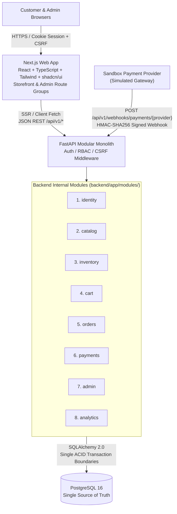
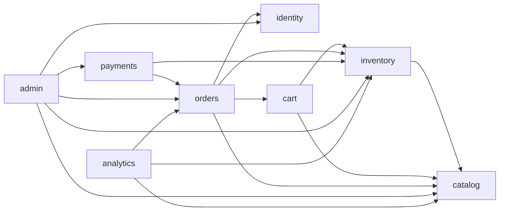

# 01 — System Architecture Overview & Module Boundaries

> **Status**: Drafted for `ARCH-001` review  
> **Scope**: Single-tenant initially, production-oriented E-commerce SaaS (storefront + admin)  
> **Baseline Disclaimer**: This architecture defines a sandbox-payment modular monolith. It is not PCI-certified and must not be deployed with live payment processing without full operational, legal, and security verification.

---

## 1. System Architecture Overview

The system is structured as a **Modular Monolith** backed by a single **PostgreSQL** database, paired with a **Next.js (App Router)** frontend application serving both the customer storefront and the staff/admin backoffice.

### 1.1 Technology Stack

| Layer | Technology | Role |
| :--- | :--- | :--- |
| **Frontend** | Next.js (App Router), React, TypeScript, Tailwind CSS, shadcn/ui | Storefront (`/`, `/products`, `/cart`, `/checkout`, `/orders`) and Admin (`/admin/*`) UI |
| **Backend API** | Python 3.12+, FastAPI, Pydantic v2 | HTTP API (`/api/v1/*`), request/response validation, RBAC, module orchestration |
| **Data Access & Migrations** | SQLAlchemy 2.0 (async/sync core + ORM), Alembic | Transactional persistence, row-level locking (`SELECT ... FOR UPDATE`), linear schema migrations |
| **Primary Database** | PostgreSQL 16 | Authoritative ACID storage for catalog, inventory reservations, carts, orders, payments, and analytics |
| **Local Runtime & CI** | Docker Compose (`web`, `api`, `db`), GitHub Actions | Reproducible local development, lint/typecheck, migration checks, and test automation |
| **Verification** | `pytest` (unit/integration/concurrency), Playwright (E2E) | Automated regression, race-condition testing, and browser user journeys |

### 1.2 High-Level Runtime Topology



### 1.3 Intentional Infrastructure Exclusions (Why Baseline Avoids Extra Complexity)

Per `AGENTS.md` and `ARCH-001` constraints, the baseline omits **Redis, Celery, Kubernetes, and microservices**:

1. **No Redis**: Auth sessions (`auth_sessions`), guest carts (`carts`), API idempotency (`orders.idempotency_key`, `payment_intents.idempotency_key`), and webhook deduplication (`payment_webhook_events`) live directly in PostgreSQL with indexed lookups. At initial single-tenant scale, sub-millisecond indexed PostgreSQL queries remove an extra stateful failure domain and eliminate cache-coherency bugs between stock counts and cached state.
2. **No Celery / Message Brokers**: Checkout stock reservation, webhook state transitions, and ledger recording execute inside single PostgreSQL ACID transactions. Expired unpaid inventory reservations are reclaimed lazily inside transactional stock/checkout checks and via an optional lightweight scheduled SQL cleanup query rather than a distributed worker fleet.
3. **No Microservices / Kubernetes**: Splitting catalog, inventory, cart, and orders across network boundaries would require distributed sagas/2PC to prevent overselling. Keeping them in one deployable FastAPI monolith allows `SELECT ... FOR UPDATE` transactions spanning `orders`, `inventory_stocks`, `inventory_reservations`, and `carts` atomically. Docker Compose (`web`, `api`, `db`) + GitHub Actions provides clean operational reproducibility.

---

## 2. Repository & Module Ownership Layout

### 2.1 Backend Modular Monolith Structure (`backend/**` except `backend/tests/**`)

```text
backend/
├── alembic/
│   └── versions/                 # Linear Alembic migration scripts
├── app/
│   ├── main.py                   # FastAPI app factory, CORS, middleware, router registration
│   ├── core/
│   │   ├── config.py             # Pydantic BaseSettings (env-only secrets, no defaults for prod secrets)
│   │   ├── database.py           # SQLAlchemy 2 engine, Session/AsyncSession factory, transaction helpers
│   │   ├── errors.py             # DomainException hierarchy & unified JSON error handler
│   │   ├── security.py           # Argon2id hashing, token hashing, HMAC webhook verifier, CSRF helpers
│   │   └── pagination.py         # Shared pagination request/response primitives
│   └── modules/
│       ├── identity/             # Users, auth sessions, RBAC dependencies
│       ├── catalog/              # Categories, products, product images
│       ├── inventory/            # Variants, stock levels, reservations, stock ledger
│       ├── cart/                 # Guest/user active carts, cart items, login merge
│       ├── orders/               # Checkout orchestration, orders, order items, order events
│       ├── payments/             # Payment intents, sandbox simulation, webhook receiver & refunds
│       ├── admin/                # User/role admin, audit log viewer, cross-module admin orchestration
│       └── analytics/            # Read-only SQL aggregations for KPIs, series, top SKUs, stock health
```

### 2.2 Frontend Route & Feature Structure (`frontend/**` except `frontend/tests/**`, `frontend/e2e/**`)

```text
frontend/
└── src/
    ├── app/
    │   ├── (storefront)/         # Public & customer routes: /, /products/[slug], /cart, /checkout, /orders, /login
    │   └── (admin)/              # Staff/Admin routes: /admin, /admin/products, /admin/orders, /admin/inventory, /admin/users
    ├── components/
    │   ├── ui/                   # shadcn/ui primitives
    │   ├── storefront/           # Storefront components
    │   └── admin/                # Admin components
    └── lib/
        ├── api/                  # Typed fetch client aligned with docs/api/openapi-contracts.md
        └── auth/                 # Session context & CSRF header injection
```

### 2.3 Acyclic Module Dependency Rules

Cross-module communication in `backend/app/modules/` goes through explicit Python service interfaces (never arbitrary cross-module ORM mutations bypassing business invariants). Allowed dependency direction:



*Note on `Orders` $\leftrightarrow$ `Payments`*: Checkout (`orders`) creates the order + initial `payment_intent` via a narrow interface or within the checkout coordinator; payment webhooks (`payments`) call `orders` state transition methods (`mark_order_paid`, `mark_order_payment_failed`, `mark_order_refunded`) which in turn call `inventory` (`commit_reservation`, `release_reservation`). Modules must never form circular imports; shared domain interfaces/DTOs live in narrow module service signatures.

---

## 3. Business Module Specifications

### Module 1: Identity and Access Management (`identity`)
* **Responsibilities**: Registration, login/logout, Argon2id password verification, server-backed HTTP-only session lifecycle, CSRF token generation/verification, role checks (`customer`, `staff`, `admin`), and profile retrieval/update.
* **Data Entities**: `users`, `auth_sessions`, `audit_logs` (shared audit sink written by `identity` and `admin`).
* **Public API Endpoints**:
  * `POST /api/v1/auth/register`
  * `POST /api/v1/auth/login`
  * `POST /api/v1/auth/logout`
  - `GET /api/v1/auth/me`
  - `PATCH /api/v1/auth/me`
* **Authorization Requirements**:
  * `register`, `login`: `anonymous` (rate-limited by IP + email).
  * `logout`, `me`: authenticated user (`customer`, `staff`, `admin`) + CSRF token on mutations (`logout`, `PATCH /me`).
* **Business Invariants**:
  * Email addresses are canonicalized (trimmed, lowercased) and globally unique.
  * Passwords are never stored or logged in plaintext; hashed with Argon2id.
  * Raw session tokens are stored only as cryptographic hashes (`SHA-256`) in `auth_sessions`; per-session CSRF tokens are derived deterministically via `HMAC-SHA256(CSRF_HMAC_SECRET, f"{session.id}:{session.csrf_version}")` without storing plaintext secrets.
  * Deactivated users (`is_active = false`) cannot log in or use existing sessions (live `users.is_active` and `users.role` are revalidated per request).
  * Self-registration always assigns `role = 'customer'`; elevated roles (`staff`, `admin`) can only be assigned by an `admin` via Module 7.
* **Error Handling**:
  * `401 AUTH_INVALID_CREDENTIALS`, `401 AUTH_SESSION_EXPIRED`, `403 AUTH_ACCOUNT_DISABLED`, `403 CSRF_INVALID`, `409 AUTH_EMAIL_ALREADY_EXISTS`, `429 RATE_LIMIT_EXCEEDED`.
* **Dependencies**: None (`core.database`, `core.security`).

---

### Module 2: Product Catalog and Categories (`catalog`)
* **Responsibilities**: Category hierarchy management, product lifecycle (`DRAFT`, `ACTIVE`, `ARCHIVED`), product image ordering, storefront browsing, search, and filtering.
* **Data Entities**: `categories`, `products`, `product_images`.
* **Public API Endpoints**:
  * Storefront (read-only): `GET /api/v1/categories`, `GET /api/v1/products`, `GET /api/v1/products/{slug}`.
  * Admin/Staff (via `/api/v1/admin/*`): `POST /api/v1/admin/categories`, `PATCH /api/v1/admin/categories/{category_id}`, `GET /api/v1/admin/products`, `POST /api/v1/admin/products`, `PATCH /api/v1/admin/products/{product_id}`, `DELETE /api/v1/admin/products/{product_id}` (soft-archive to `ARCHIVED`).
* **Authorization Requirements**:
  * Storefront endpoints: public (`anonymous`+); return **only** `ACTIVE` products and active categories.
  * Admin catalog endpoints: `staff` or `admin` + CSRF token on mutations.
* **Business Invariants**:
  * Category and product `slug` values are globally unique lowercase URL-safe identifiers.
  * A category cannot be its own parent or form a parent cycle.
  * A product must have at least one active variant with `price_cents >= 0` before transitioning from `DRAFT` to `ACTIVE`.
  * Deleting a product transitions its status to `ARCHIVED` rather than hard-deleting, preserving historical `order_items` foreign-key integrity.
* **Error Handling**:
  * `404 CATEGORY_NOT_FOUND`, `404 PRODUCT_NOT_FOUND`, `409 SLUG_CONFLICT`, `422 PRODUCT_CANNOT_ACTIVATE_WITHOUT_VARIANT`, `422 CATEGORY_CYCLE_DETECTED`.
* **Dependencies**: `identity` (RBAC dependencies on admin endpoints); exposes read queries to `inventory`, `cart`, `orders`, `analytics`.

---

### Module 3: Product Variants and Inventory (`inventory`)
* **Responsibilities**: Managing SKUs, variant attributes and authoritative server prices, stock quantities (`on_hand`, `reserved`), low-stock thresholds, transactional stock reservation/commit/release, lazy expiration cleanup, and immutable stock ledger auditing.
* **Data Entities**: `product_variants`, `inventory_stocks`, `inventory_reservations`, `inventory_ledger_entries`.
* **Public API Endpoints**:
  * Storefront: `GET /api/v1/variants/{variant_id}/availability` (plus availability embedded in `GET /api/v1/products/{slug}`).
  * Admin/Staff: `POST /api/v1/admin/products/{product_id}/variants`, `PATCH /api/v1/admin/variants/{variant_id}`, `POST /api/v1/admin/inventory/{variant_id}/adjust`, `GET /api/v1/admin/inventory/{variant_id}/ledger`.
* **Authorization Requirements**:
  * Availability reads: public (`anonymous`+).
  * Variant & stock mutations + ledger reads: `staff` or `admin` + CSRF on mutations.
* **Business Invariants**:
  * `price_cents >= 0`; `compare_at_price_cents` is either `NULL` or `>= price_cents`.
  * `on_hand >= 0`, `reserved >= 0`, and `reserved <= on_hand` enforced at both application and PostgreSQL `CHECK` constraint levels.
  * Available sellable quantity is strictly `on_hand - reserved`.
  * Multi-SKU reservation locks `inventory_stocks` rows in deterministic `variant_id` ascending order (`ORDER BY variant_id ASC FOR UPDATE`) to eliminate deadlocks.
  * Every stock mutation (`INITIAL_SEED`, `MANUAL_ADJUSTMENT`, `RESERVE`, `COMMIT`, `RELEASE`, `RETURN_RESTOCK`) appends an immutable `inventory_ledger_entries` row within the same DB transaction.
* **Error Handling**:
  * `404 VARIANT_NOT_FOUND`, `409 SKU_CONFLICT`, `409 INSUFFICIENT_STOCK` (includes `variant_id`, `requested`, `available`), `422 INVALID_STOCK_ADJUSTMENT`.
* **Dependencies**: `catalog` (product existence/status), `identity` (actor for manual adjustments).

---

### Module 4: Shopping Cart (`cart`)
* **Responsibilities**: Managing active shopping carts for guests (via HTTP-only `ecom_guest_cart` cookie) and authenticated customers (`user_id`), enforcing item quantity limits, live price/stock projection on read, and merging guest carts upon login.
* **Data Entities**: `carts`, `cart_items`.
* **Public API Endpoints**:
  * `GET /api/v1/cart`
  * `POST /api/v1/cart/items`
  * `PATCH /api/v1/cart/items/{item_id}`
  * `DELETE /api/v1/cart/items/{item_id}`
  * `DELETE /api/v1/cart`
  * `POST /api/v1/cart/merge`
* **Authorization Requirements**:
  * Accessible to `anonymous` (with `ecom_guest_cart` cookie) and authenticated users (`customer`, `staff`, `admin`).
  * `POST /api/v1/cart/merge` requires authenticated user + valid `ecom_guest_cart` cookie + CSRF token.
  * Ownership check: a user or guest can only view/modify items belonging to their own active cart.
* **Business Invariants**:
  * At most one `ACTIVE` cart per authenticated `user_id` (enforced via PostgreSQL partial unique index).
  * `cart_items` stores **no prices**; `GET /api/v1/cart` always joins `product_variants` and `inventory_stocks` to return current server prices, subtotal, and stock warnings.
  * Only `ACTIVE` variants belonging to `ACTIVE` products can be added to a cart; quantity per line item is bounded (`1 <= quantity <= 99` and `<= available` stock on add/update).
* **Error Handling**:
  * `404 CART_ITEM_NOT_FOUND`, `409 VARIANT_UNAVAILABLE`, `409 INSUFFICIENT_STOCK`, `422 INVALID_QUANTITY`.
* **Dependencies**: `catalog`, `inventory`, `identity`.

---

### Module 5: Checkout and Orders (`orders`)
* **Responsibilities**: Converting an active cart into a persistent order inside a single transaction, enforcing `Idempotency-Key` deduplication, computing server-authoritative totals (subtotal, shipping, tax, total), creating line-item snapshots, coordinating inventory reservation and initial payment intent creation, listing customer orders, and handling order cancellation and admin fulfillment transitions.
* **Data Entities**: `orders`, `order_items`, `order_events`.
* **Public API Endpoints**:
  * Customer/Guest: `POST /api/v1/checkout/orders`, `GET /api/v1/orders` (auth required), `GET /api/v1/orders/{order_number}`, `POST /api/v1/orders/{order_number}/cancel`.
  * Admin/Staff: `GET /api/v1/admin/orders`, `GET /api/v1/admin/orders/{order_number}`, `POST /api/v1/admin/orders/{order_number}/fulfill`, `POST /api/v1/admin/orders/{order_number}/cancel`.
* **Authorization Requirements**:
  * `POST /api/v1/checkout/orders`: `anonymous` (issues HMAC-derived guest order token in `ecom_guest_orders` HTTP-only cookie + response) or authenticated user (CSRF + `Origin` validation enforced).
  * `GET /api/v1/orders`: authenticated user only (returns `WHERE user_id = current_user.id`).
  * `GET /api/v1/orders/{order_number}` and `POST /api/v1/orders/{order_number}/cancel`: strictly resource owner (`order.user_id == current_user.id`) or valid guest order token (`ecom_guest_orders` / `X-Guest-Order-Token`). Staff and admin use `/api/v1/admin/orders/*`.
  * Admin endpoints: `staff` or `admin` (`admin` only for paid refunds) + CSRF on mutations.
* **Business Invariants**:
  * **Server-Authoritative Totals**: Client-submitted prices, totals, or discounts are ignored/rejected; totals are computed exclusively from `product_variants.price_cents` and server shipping/tax rules.
  * **Idempotent Checkout**: `Idempotency-Key` header is required and unique per checkout attempt; duplicate requests with the same key and same cart/actor return the existing order (`200 OK`) rather than creating duplicate orders or double-reserving stock. Reusing an `Idempotency-Key` with a different payload/actor returns `409 IDEMPOTENCY_KEY_CONFLICT`.
  * **Explicit Separation of Payment & Fulfillment**: An order cannot advance to `PROCESSING`, `SHIPPED`, or `COMPLETED` unless `payment_status == 'PAID'` and `status == 'CONFIRMED'` (or subsequent fulfillment states).
  * Every status change appends an immutable `order_events` row.
* **Error Handling**:
  * `400 IDEMPOTENCY_KEY_REQUIRED`, `404 ORDER_NOT_FOUND`, `409 CART_EMPTY`, `409 INSUFFICIENT_STOCK`, `409 IDEMPOTENCY_KEY_CONFLICT`, `409 INVALID_ORDER_STATE_TRANSITION`.
* **Dependencies**: `cart`, `inventory`, `catalog`, `identity`, `payments` (intent initiation).

---

### Module 6: Payments and Webhook Processing (`payments`)
* **Responsibilities**: Managing sandbox payment intents, verifying HMAC-SHA256 webhook signatures and replay timestamps, guaranteeing idempotent webhook processing via `payment_webhook_events`, transitioning orders & inventory reservations on payment confirmation/failure, and handling admin-initiated sandbox refunds.
* **Data Entities**: `payment_intents`, `payment_webhook_events`.
* **Public API Endpoints**:
  * `POST /api/v1/payments/intents` (creates/retrieves intent for an unpaid `PENDING_PAYMENT` order)
  * `POST /api/v1/payments/sandbox/{provider_intent_id}/simulate` (sandbox dev/test trigger, disabled when `PAYMENT_SANDBOX_MODE != true`)
  * `POST /api/v1/webhooks/payments/{provider}` (HMAC-signed webhook receiver)
  * `POST /api/v1/admin/orders/{order_number}/refund` (admin refund trigger)
* **Authorization Requirements**:
  * `POST /api/v1/payments/intents` and `/simulate`: order owner / valid guest order token / `staff`/`admin` + CSRF (when cookie session active).
  * `POST /api/v1/webhooks/payments/{provider}`: unauthenticated by user cookie; authenticated exclusively via cryptographic `X-Webhook-Signature` HMAC-SHA256 over raw body + timestamp (`<= 300s` skew). No CSRF cookie check.
  * `POST /api/v1/admin/orders/{order_number}/refund`: `admin` role only (stricter than `staff`) + CSRF + `audit_logs` entry.
* **Business Invariants**:
  * **Zero Card Data**: Never collects, logs, or stores PAN, CVV, or card expiration numbers.
  * **Idempotent Webhooks**: Unique constraint on `(provider, provider_event_id)` in `payment_webhook_events`. Duplicate deliveries return `200 OK` (`IGNORED_DUPLICATE`) without re-applying stock commits or order events.
  * **Signature Before State Mutation**: Raw request bytes are verified via constant-time `hmac.compare_digest` before any database mutation; unverified payloads are rejected with `401 WEBHOOK_SIGNATURE_INVALID`.
  * Payment amount (`payment_intents.amount_cents`) must match `orders.total_cents` and currency.
* **Error Handling**:
  * `401 WEBHOOK_SIGNATURE_INVALID`, `400 WEBHOOK_TIMESTAMP_EXPIRED`, `404 PROVIDER_NOT_FOUND`, `404 PAYMENT_INTENT_NOT_FOUND`, `409 ORDER_NOT_PAYABLE`, `409 REFUND_NOT_ALLOWED`, `403 SANDBOX_MODE_DISABLED`.
* **Dependencies**: `orders`, `inventory` (via `orders` transitions), `identity`.

---

### Module 7: Administrative Management (`admin`)
* **Responsibilities**: User account administration (`staff`/`admin` role assignment, account activation/deactivation), read-only audit log browsing, and central admin RBAC + `audit_logs` recording across privileged operations.
* **Data Entities**: Reads/updates `users` (owned by `identity`), owns admin-scoped reads on `audit_logs`.
* **Public API Endpoints**:
  * `GET /api/v1/admin/users`
  * `PATCH /api/v1/admin/users/{user_id}/role`
  * `PATCH /api/v1/admin/users/{user_id}/status`
  * `GET /api/v1/admin/audit-logs`
  * *(Admin catalog, inventory, order, refund, and analytics routes live under `/api/v1/admin/*` and invoke their respective module services.)*
* **Authorization Requirements**:
  * User management & audit logs: `admin` only + CSRF.
  * Catalog, inventory, order fulfillment, and analytics views: `staff` or `admin` (except refunds, which are `admin` only).
* **Business Invariants**:
  * An `admin` cannot deactivate or demote themselves, or demote/deactivate the last remaining active `admin` user in the database.
  * Role changes and deactivation immediately revoke all active `auth_sessions` for the target user.
  * All privileged admin mutations (role/status changes, category/product/variant changes, stock adjustments, order fulfillment/cancellation, refunds) write a structured `audit_logs` row with actor, target resource, secret-redacted before/after state, and IP.
* **Error Handling**:
  * `403 FORBIDDEN_ROLE`, `404 USER_NOT_FOUND`, `409 CANNOT_REMOVE_LAST_ADMIN`, `409 CANNOT_DEACTIVATE_SELF`, `409 CANNOT_DEMOTE_SELF`.
* **Dependencies**: `identity`, `catalog`, `inventory`, `orders`, `payments`.

---

### Module 8: Sales Analytics (`analytics`)
* **Responsibilities**: Computing accurate, real-time sales KPIs, daily time-series, top-performing products/variants, and inventory health metrics directly from persisted PostgreSQL tables (`orders`, `order_items`, `inventory_stocks`, `carts`).
* **Data Entities**: Read-only access to `orders`, `order_items`, `product_variants`, `products`, `inventory_stocks`, `inventory_reservations`, `carts` (no separate analytics write tables in baseline).
* **Public API Endpoints**:
  * `GET /api/v1/admin/analytics/summary`
  * `GET /api/v1/admin/analytics/timeseries`
  * `GET /api/v1/admin/analytics/top-products`
  * `GET /api/v1/admin/analytics/inventory-health`
* **Authorization Requirements**:
  * `staff` or `admin` only (`403 FORBIDDEN_ROLE` for `customer` / `anonymous`).
* **Business Invariants**:
  * Revenue KPIs exclude unpaid (`PENDING_PAYMENT`), failed, and cancelled orders (`payment_status = 'PAID'` or explicitly reconciled net revenue deducting `REFUNDED` orders).
  * Queries require bounded date ranges (default 30 days, max 366 days) and use covering indexes on `orders(paid_at, status, payment_status)` to prevent full-table analytical scans.
  * Analytics never modify business data and never fabricate or extrapolate data.
* **Error Handling**:
  * `400 INVALID_DATE_RANGE` (`from > to` or span `> 366` days), `403 FORBIDDEN_ROLE`.
* **Dependencies**: Read-only queries across `orders`, `inventory`, `catalog`, `cart`, `identity`.
