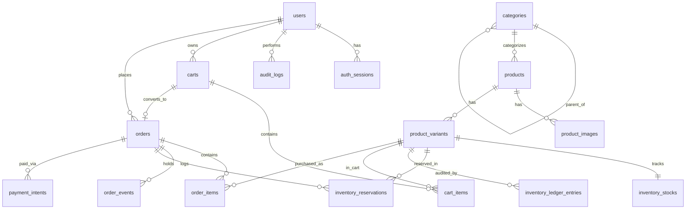

# 02 — PostgreSQL Data Model, ERD & Analytics Model

> **Engine**: PostgreSQL 16  
> **ORM & Migrations**: SQLAlchemy 2.0 + Alembic (single linear migration head)  
> **Monetary Representation**: Integer minor units (`*_cents` `INTEGER`/`BIGINT`) + ISO-4217 `CHAR(3)` currency (`USD` default). Floating-point types (`FLOAT`/`REAL`) are strictly prohibited for money.

---

## 1. Entity Relationship Diagram

---

## 2. Table Definitions, Constraints & Indexes

### 2.1 Identity & Audit (`identity`, `admin`)

#### `users`
| Column | Type | Constraints | Notes |
| :--- | :--- | :--- | :--- |
| `id` | `UUID` | `PK, DEFAULT gen_random_uuid()` | |
| `email` | `VARCHAR(320)` | `NOT NULL` | Normalized lowercase in app; unique functional index `LOWER(email)` |
| `password_hash` | `VARCHAR(255)` | `NOT NULL` | Argon2id encoded hash |
| `full_name` | `VARCHAR(120)` | `NOT NULL` | |
| `role` | `VARCHAR(16)` | `NOT NULL, DEFAULT 'customer', CHECK (role IN ('customer','staff','admin'))` | |
| `is_active` | `BOOLEAN` | `NOT NULL, DEFAULT true` | Soft account suspension |
| `created_at` | `TIMESTAMPTZ` | `NOT NULL, DEFAULT now()` | |
| `updated_at` | `TIMESTAMPTZ` | `NOT NULL, DEFAULT now()` | |
* **Indexes**: `UNIQUE INDEX uq_users_email_lower ON users (LOWER(email))`.

#### `auth_sessions`
| Column | Type | Constraints | Notes |
| :--- | :--- | :--- | :--- |
| `id` | `UUID` | `PK, DEFAULT gen_random_uuid()` | |
| `user_id` | `UUID` | `NOT NULL, FK -> users(id) ON DELETE CASCADE` | |
| `token_hash` | `CHAR(64)` | `NOT NULL, UNIQUE` | Hex SHA-256 of `ecom_session` cookie secret |
| `csrf_version` | `INTEGER` | `NOT NULL, DEFAULT 1, CHECK (csrf_version >= 1)` | Combined with `CSRF_HMAC_SECRET` + `id` to derive deterministic CSRF token |
| `ip_address` | `INET` | `NULL` | |
| `user_agent` | `VARCHAR(512)` | `NULL` | |
| `expires_at` | `TIMESTAMPTZ` | `NOT NULL` | |
| `revoked_at` | `TIMESTAMPTZ` | `NULL` | Set on logout / password change / admin disable |
| `created_at` | `TIMESTAMPTZ` | `NOT NULL, DEFAULT now()` | |
* **Indexes**: `INDEX idx_auth_sessions_user_active ON auth_sessions (user_id, expires_at) WHERE revoked_at IS NULL`.

#### `audit_logs`
| Column | Type | Constraints | Notes |
| :--- | :--- | :--- | :--- |
| `id` | `UUID` | `PK, DEFAULT gen_random_uuid()` | |
| `actor_user_id` | `UUID` | `NULL, FK -> users(id) ON DELETE SET NULL` | |
| `action` | `VARCHAR(64)` | `NOT NULL` | e.g., `USER_ROLE_UPDATED`, `STOCK_ADJUSTED`, `ORDER_REFUNDED` |
| `resource_type` | `VARCHAR(48)` | `NOT NULL` | e.g., `user`, `product`, `inventory_stock`, `order` |
| `resource_id` | `VARCHAR(64)` | `NOT NULL` | UUID or order_number |
| `before_state` | `JSONB` | `NULL` | Redacted snapshot (never secrets/passwords) |
| `after_state` | `JSONB` | `NULL` | |
| `ip_address` | `INET` | `NULL` | |
| `created_at` | `TIMESTAMPTZ` | `NOT NULL, DEFAULT now()` | Append-only |
* **Indexes**: `INDEX idx_audit_logs_created_at ON audit_logs (created_at DESC)`, `INDEX idx_audit_logs_resource ON audit_logs (resource_type, resource_id)`.

---

### 2.2 Product Catalog (`catalog`)

#### `categories`
| Column | Type | Constraints | Notes |
| :--- | :--- | :--- | :--- |
| `id` | `UUID` | `PK, DEFAULT gen_random_uuid()` | |
| `parent_id` | `UUID` | `NULL, FK -> categories(id) ON DELETE RESTRICT` | Cannot equal `id` (`CHECK (parent_id <> id)`) |
| `name` | `VARCHAR(120)` | `NOT NULL` | |
| `slug` | `VARCHAR(140)` | `NOT NULL, UNIQUE` | Lowercase kebab-case |
| `description` | `TEXT` | `NULL` | |
| `is_active` | `BOOLEAN` | `NOT NULL, DEFAULT true` | |
| `sort_order` | `INTEGER` | `NOT NULL, DEFAULT 0` | |
| `created_at` | `TIMESTAMPTZ` | `NOT NULL, DEFAULT now()` | |
| `updated_at` | `TIMESTAMPTZ` | `NOT NULL, DEFAULT now()` | |
* **Indexes**: `INDEX idx_categories_active_sort ON categories (is_active, sort_order)`.

#### `products`
| Column | Type | Constraints | Notes |
| :--- | :--- | :--- | :--- |
| `id` | `UUID` | `PK, DEFAULT gen_random_uuid()` | |
| `category_id` | `UUID` | `NOT NULL, FK -> categories(id) ON DELETE RESTRICT` | |
| `title` | `VARCHAR(200)` | `NOT NULL` | |
| `slug` | `VARCHAR(220)` | `NOT NULL, UNIQUE` | |
| `description` | `TEXT` | `NOT NULL, DEFAULT ''` | |
| `status` | `VARCHAR(16)` | `NOT NULL, DEFAULT 'DRAFT', CHECK (status IN ('DRAFT','ACTIVE','ARCHIVED'))` | |
| `created_at` | `TIMESTAMPTZ` | `NOT NULL, DEFAULT now()` | |
| `updated_at` | `TIMESTAMPTZ` | `NOT NULL, DEFAULT now()` | |
* **Indexes**: `INDEX idx_products_status_category ON products (status, category_id, created_at DESC)`.

#### `product_images`
| Column | Type | Constraints | Notes |
| :--- | :--- | :--- | :--- |
| `id` | `UUID` | `PK, DEFAULT gen_random_uuid()` | |
| `product_id` | `UUID` | `NOT NULL, FK -> products(id) ON DELETE CASCADE` | |
| `url` | `VARCHAR(500)` | `NOT NULL` | Validated `https://` or relative `/assets/` path |
| `alt_text` | `VARCHAR(200)` | `NOT NULL, DEFAULT ''` | Accessibility requirement |
| `sort_order` | `INTEGER` | `NOT NULL, DEFAULT 0` | |
| `is_primary` | `BOOLEAN` | `NOT NULL, DEFAULT false` | Partial unique index `WHERE is_primary = true` per `product_id` |
* **Indexes**: `UNIQUE INDEX uq_product_primary_image ON product_images (product_id) WHERE is_primary = true`.

---

### 2.3 Product Variants & Inventory (`inventory`)

#### `product_variants`
| Column | Type | Constraints | Notes |
| :--- | :--- | :--- | :--- |
| `id` | `UUID` | `PK, DEFAULT gen_random_uuid()` | |
| `product_id` | `UUID` | `NOT NULL, FK -> products(id) ON DELETE RESTRICT` | |
| `sku` | `VARCHAR(64)` | `NOT NULL, UNIQUE` | |
| `title` | `VARCHAR(160)` | `NOT NULL` | e.g., `"Midnight Blue / Large"` |
| `attributes_json` | `JSONB` | `NOT NULL, DEFAULT '{}'` | e.g., `{"color": "Blue", "size": "L"}` |
| `price_cents` | `INTEGER` | `NOT NULL, CHECK (price_cents >= 0)` | Authoritative unit price |
| `compare_at_price_cents` | `INTEGER` | `NULL, CHECK (compare_at_price_cents IS NULL OR compare_at_price_cents >= price_cents)` | Optional original price |
| `currency` | `CHAR(3)` | `NOT NULL, DEFAULT 'USD'` | |
| `is_active` | `BOOLEAN` | `NOT NULL, DEFAULT true` | |
| `created_at` | `TIMESTAMPTZ` | `NOT NULL, DEFAULT now()` | |
| `updated_at` | `TIMESTAMPTZ` | `NOT NULL, DEFAULT now()` | |
* **Indexes**: `INDEX idx_variants_product_active ON product_variants (product_id, is_active)`.

#### `inventory_stocks`
| Column | Type | Constraints | Notes |
| :--- | :--- | :--- | :--- |
| `variant_id` | `UUID` | `PK, FK -> product_variants(id) ON DELETE CASCADE` | 1:1 with `product_variants` |
| `on_hand` | `INTEGER` | `NOT NULL, DEFAULT 0, CHECK (on_hand >= 0)` | Physical units currently held |
| `reserved` | `INTEGER` | `NOT NULL, DEFAULT 0, CHECK (reserved >= 0)` | Units held by `ACTIVE` reservations |
| *(table check)* | | `CHECK (reserved <= on_hand)` | Hard database-level oversell prevention |
| `low_stock_threshold` | `INTEGER` | `NOT NULL, DEFAULT 5, CHECK (low_stock_threshold >= 0)` | |
| `version` | `INTEGER` | `NOT NULL, DEFAULT 1` | Incremented on every mutation |
| `updated_at` | `TIMESTAMPTZ` | `NOT NULL, DEFAULT now()` | |

#### `inventory_reservations`
| Column | Type | Constraints | Notes |
| :--- | :--- | :--- | :--- |
| `id` | `UUID` | `PK, DEFAULT gen_random_uuid()` | |
| `order_id` | `UUID` | `NOT NULL, FK -> orders(id) ON DELETE CASCADE` | |
| `variant_id` | `UUID` | `NOT NULL, FK -> product_variants(id) ON DELETE RESTRICT` | |
| `quantity` | `INTEGER` | `NOT NULL, CHECK (quantity > 0)` | |
| `status` | `VARCHAR(16)` | `NOT NULL, CHECK (status IN ('ACTIVE','COMMITTED','RELEASED','EXPIRED'))` | |
| `expires_at` | `TIMESTAMPTZ` | `NOT NULL` | `created_at + 15 minutes` while `ACTIVE` |
| `created_at` | `TIMESTAMPTZ` | `NOT NULL, DEFAULT now()` | |
| `updated_at` | `TIMESTAMPTZ` | `NOT NULL, DEFAULT now()` | |
* **Indexes**: `UNIQUE INDEX uq_reservation_order_variant ON inventory_reservations (order_id, variant_id)`, `INDEX idx_reservations_active_expiry ON inventory_reservations (expires_at) WHERE status = 'ACTIVE'`.

#### `inventory_ledger_entries`
| Column | Type | Constraints | Notes |
| :--- | :--- | :--- | :--- |
| `id` | `UUID` | `PK, DEFAULT gen_random_uuid()` | |
| `variant_id` | `UUID` | `NOT NULL, FK -> product_variants(id) ON DELETE RESTRICT` | |
| `order_id` | `UUID` | `NULL, FK -> orders(id) ON DELETE SET NULL` | |
| `actor_user_id` | `UUID` | `NULL, FK -> users(id) ON DELETE SET NULL` | |
| `reason` | `VARCHAR(24)` | `NOT NULL, CHECK (reason IN ('INITIAL_SEED','MANUAL_ADJUSTMENT','RESERVE','COMMIT','RELEASE','RETURN_RESTOCK'))` | |
| `delta_on_hand` | `INTEGER` | `NOT NULL` | Signed change to `on_hand` |
| `delta_reserved` | `INTEGER` | `NOT NULL` | Signed change to `reserved` |
| `on_hand_after` | `INTEGER` | `NOT NULL, CHECK (on_hand_after >= 0)` | |
| `reserved_after` | `INTEGER` | `NOT NULL, CHECK (reserved_after >= 0 AND reserved_after <= on_hand_after)` | |
| `note` | `VARCHAR(255)` | `NULL` | Required for manual adjustments |
| `created_at` | `TIMESTAMPTZ` | `NOT NULL, DEFAULT now()` | Append-only |
* **Indexes**: `INDEX idx_ledger_variant_created ON inventory_ledger_entries (variant_id, created_at DESC)`.

---

### 2.4 Shopping Cart (`cart`)

#### `carts`
| Column | Type | Constraints | Notes |
| :--- | :--- | :--- | :--- |
| `id` | `UUID` | `PK, DEFAULT gen_random_uuid()` | |
| `user_id` | `UUID` | `NULL, FK -> users(id) ON DELETE CASCADE` | Populated for authenticated user carts |
| `guest_token_hash` | `CHAR(64)` | `NULL, UNIQUE` | Hex SHA-256 of `ecom_guest_cart` HTTP-only cookie |
| `status` | `VARCHAR(16)` | `NOT NULL, DEFAULT 'ACTIVE', CHECK (status IN ('ACTIVE','CONVERTED','ABANDONED'))` | |
| `currency` | `CHAR(3)` | `NOT NULL, DEFAULT 'USD'` | |
| `expires_at` | `TIMESTAMPTZ` | `NOT NULL` | Rolling expiry (30 days) |
| `created_at` | `TIMESTAMPTZ` | `NOT NULL, DEFAULT now()` | |
| `updated_at` | `TIMESTAMPTZ` | `NOT NULL, DEFAULT now()` | |
* **Indexes**: `UNIQUE INDEX uq_active_user_cart ON carts (user_id) WHERE status = 'ACTIVE' AND user_id IS NOT NULL`, `CHECK (user_id IS NOT NULL OR guest_token_hash IS NOT NULL)`.

#### `cart_items`
| Column | Type | Constraints | Notes |
| :--- | :--- | :--- | :--- |
| `id` | `UUID` | `PK, DEFAULT gen_random_uuid()` | |
| `cart_id` | `UUID` | `NOT NULL, FK -> carts(id) ON DELETE CASCADE` | |
| `variant_id` | `UUID` | `NOT NULL, FK -> product_variants(id) ON DELETE RESTRICT` | |
| `quantity` | `INTEGER` | `NOT NULL, CHECK (quantity > 0 AND quantity <= 99)` | No price stored on cart item |
| `created_at` | `TIMESTAMPTZ` | `NOT NULL, DEFAULT now()` | |
| `updated_at` | `TIMESTAMPTZ` | `NOT NULL, DEFAULT now()` | |
* **Indexes**: `UNIQUE INDEX uq_cart_variant ON cart_items (cart_id, variant_id)`.

---

### 2.5 Checkout & Orders (`orders`)

#### `orders`
| Column | Type | Constraints | Notes |
| :--- | :--- | :--- | :--- |
| `id` | `UUID` | `PK, DEFAULT gen_random_uuid()` | |
| `order_number` | `VARCHAR(32)` | `NOT NULL, UNIQUE` | Human-readable e.g. `ORD-20261118-8F3K2A` |
| `user_id` | `UUID` | `NULL, FK -> users(id) ON DELETE SET NULL` | Null only on guest checkout |
| `cart_id` | `UUID` | `NULL, FK -> carts(id) ON DELETE SET NULL` | Source cart |
| `customer_email` | `VARCHAR(320)` | `NOT NULL` | |
| `guest_token_version` | `INTEGER` | `NOT NULL, DEFAULT 1, CHECK (guest_token_version >= 1)` | Used with `GUEST_ORDER_HMAC_SECRET` to derive deterministic guest receipt token |
| `guest_access_expires_at` | `TIMESTAMPTZ` | `NULL` | `placed_at + 30 days` for guest orders; `NULL` for authenticated orders |
| `status` | `VARCHAR(24)` | `NOT NULL, CHECK (status IN ('PENDING_PAYMENT','CONFIRMED','PROCESSING','SHIPPED','COMPLETED','CANCELLED','REFUNDED'))` | |
| `payment_status` | `VARCHAR(24)` | `NOT NULL, CHECK (payment_status IN ('REQUIRES_PAYMENT','PAID','FAILED','REFUNDED','CANCELLED'))` | |
| `fulfillment_status` | `VARCHAR(24)` | `NOT NULL, CHECK (fulfillment_status IN ('UNFULFILLED','ALLOCATED','SHIPPED','DELIVERED','CANCELLED','RETURNED'))` | |
| `currency` | `CHAR(3)` | `NOT NULL, DEFAULT 'USD'` | |
| `subtotal_cents` | `INTEGER` | `NOT NULL, CHECK (subtotal_cents >= 0)` | |
| `discount_cents` | `INTEGER` | `NOT NULL, DEFAULT 0, CHECK (discount_cents >= 0 AND discount_cents <= subtotal_cents)` | |
| `shipping_cents` | `INTEGER` | `NOT NULL, DEFAULT 0, CHECK (shipping_cents >= 0)` | |
| `tax_cents` | `INTEGER` | `NOT NULL, DEFAULT 0, CHECK (tax_cents >= 0)` | |
| `total_cents` | `INTEGER` | `NOT NULL, CHECK (total_cents >= 0 AND total_cents = subtotal_cents - discount_cents + shipping_cents + tax_cents)` | Server-computed invariant |
| `idempotency_key` | `CHAR(64)` | `NOT NULL, UNIQUE` | Hex `SHA-256(f"{actor_scope}:{client_key}")` |
| `request_fingerprint` | `CHAR(64)` | `NOT NULL` | Hex `SHA-256` of canonical `(cart_id, sorted_items, email, addresses)` |
| `shipping_address_json` | `JSONB` | `NOT NULL` | Validated Pydantic address schema |
| `billing_address_json` | `JSONB` | `NOT NULL` | |
| `placed_at` | `TIMESTAMPTZ` | `NOT NULL, DEFAULT now()` | |
| `paid_at` | `TIMESTAMPTZ` | `NULL` | Set exclusively on payment confirmation |
| `shipped_at` | `TIMESTAMPTZ` | `NULL` | |
| `completed_at` | `TIMESTAMPTZ` | `NULL` | |
| `cancelled_at` | `TIMESTAMPTZ` | `NULL` | |
| `cancellation_reason` | `VARCHAR(255)` | `NULL` | |
| `updated_at` | `TIMESTAMPTZ` | `NOT NULL, DEFAULT now()` | |
* **Indexes**:
  * `INDEX idx_orders_user_placed ON orders (user_id, placed_at DESC) WHERE user_id IS NOT NULL`
  * `INDEX idx_orders_status_placed ON orders (status, placed_at DESC)`
  * `INDEX idx_orders_analytics_paid_at ON orders (paid_at, status, payment_status)`

#### `order_items`
| Column | Type | Constraints | Notes |
| :--- | :--- | :--- | :--- |
| `id` | `UUID` | `PK, DEFAULT gen_random_uuid()` | |
| `order_id` | `UUID` | `NOT NULL, FK -> orders(id) ON DELETE CASCADE` | |
| `product_id` | `UUID` | `NOT NULL, FK -> products(id) ON DELETE RESTRICT` | |
| `variant_id` | `UUID` | `NOT NULL, FK -> product_variants(id) ON DELETE RESTRICT` | |
| `sku_snapshot` | `VARCHAR(64)` | `NOT NULL` | Immutable at checkout |
| `product_title_snapshot` | `VARCHAR(200)` | `NOT NULL` | Immutable at checkout |
| `variant_title_snapshot` | `VARCHAR(160)` | `NOT NULL` | Immutable at checkout |
| `attributes_snapshot_json` | `JSONB` | `NOT NULL` | |
| `unit_price_cents` | `INTEGER` | `NOT NULL, CHECK (unit_price_cents >= 0)` | |
| `quantity` | `INTEGER` | `NOT NULL, CHECK (quantity > 0)` | |
| `line_total_cents` | `INTEGER` | `NOT NULL, CHECK (line_total_cents = unit_price_cents * quantity)` | |
* **Indexes**: `INDEX idx_order_items_order ON order_items (order_id)`, `INDEX idx_order_items_variant_order ON order_items (variant_id, order_id)`.

#### `order_events`
| Column | Type | Constraints | Notes |
| :--- | :--- | :--- | :--- |
| `id` | `UUID` | `PK, DEFAULT gen_random_uuid()` | |
| `order_id` | `UUID` | `NOT NULL, FK -> orders(id) ON DELETE CASCADE` | |
| `actor_user_id` | `UUID` | `NULL, FK -> users(id) ON DELETE SET NULL` | Null for system/webhook |
| `event_type` | `VARCHAR(48)` | `NOT NULL` | e.g. `ORDER_CREATED`, `PAYMENT_SUCCEEDED`, `ORDER_SHIPPED`, `ORDER_CANCELLED` |
| `from_status` | `VARCHAR(24)` | `NULL` | |
| `to_status` | `VARCHAR(24)` | `NOT NULL` | |
| `metadata_json` | `JSONB` | `NOT NULL, DEFAULT '{}'` | Tracking number, webhook event ID, note |
| `created_at` | `TIMESTAMPTZ` | `NOT NULL, DEFAULT now()` | Append-only |
* **Indexes**: `INDEX idx_order_events_order_created ON order_events (order_id, created_at ASC)`.

---

### 2.6 Payments & Webhooks (`payments`)

#### `payment_intents`
| Column | Type | Constraints | Notes |
| :--- | :--- | :--- | :--- |
| `id` | `UUID` | `PK, DEFAULT gen_random_uuid()` | |
| `order_id` | `UUID` | `NOT NULL, FK -> orders(id) ON DELETE CASCADE` | |
| `provider` | `VARCHAR(32)` | `NOT NULL, DEFAULT 'sandbox_simpay'` | |
| `provider_intent_id` | `VARCHAR(128)` | `NOT NULL, UNIQUE` | e.g., `pi_sandbox_<uuid>` |
| `idempotency_key` | `CHAR(64)` | `NOT NULL, UNIQUE` | Hex `SHA-256(f"{actor_scope}:{client_key}")` (or `SHA-256(f"checkout-init:{order_id}")`) |
| `request_fingerprint` | `CHAR(64)` | `NOT NULL` | Hex `SHA-256` of canonical `(order_number, amount_cents, currency)` |
| `amount_cents` | `INTEGER` | `NOT NULL, CHECK (amount_cents >= 0)` | Must match `orders.total_cents` |
| `currency` | `CHAR(3)` | `NOT NULL, DEFAULT 'USD'` | |
| `status` | `VARCHAR(24)` | `NOT NULL, CHECK (status IN ('REQUIRES_ACTION','PROCESSING','SUCCEEDED','FAILED','CANCELLED','REFUNDED'))` | |
| `failure_code` | `VARCHAR(64)` | `NULL` | |
| `failure_message` | `VARCHAR(255)` | `NULL` | |
| `created_at` | `TIMESTAMPTZ` | `NOT NULL, DEFAULT now()` | |
| `updated_at` | `TIMESTAMPTZ` | `NOT NULL, DEFAULT now()` | |
* **Indexes**: `INDEX idx_payment_intents_order ON payment_intents (order_id, created_at DESC)`, `UNIQUE INDEX uq_active_succeeded_intent_per_order ON payment_intents (order_id) WHERE status = 'SUCCEEDED'` (prevents double payment capture on one order).

#### `payment_webhook_events`
| Column | Type | Constraints | Notes |
| :--- | :--- | :--- | :--- |
| `id` | `UUID` | `PK, DEFAULT gen_random_uuid()` | |
| `provider` | `VARCHAR(32)` | `NOT NULL` | Must match allowlisted provider (`sandbox_simpay`) |
| `provider_event_id` | `VARCHAR(128)` | `NOT NULL` | Provider-assigned event ID |
| `event_type` | `VARCHAR(64)` | `NOT NULL` | `payment_intent.succeeded`, `payment_intent.failed`, `charge.refunded` |
| `signature_verified` | `BOOLEAN` | `NOT NULL` | Always `true` for stored processed events |
| `payload_json` | `JSONB` | `NOT NULL` | Sanitised provider event payload |
| `status` | `VARCHAR(24)` | `NOT NULL, CHECK (status IN ('PROCESSING','PROCESSED','FAILED'))` | Duplicates return `IGNORED_DUPLICATE` at HTTP layer via `ON CONFLICT DO NOTHING` |
| `received_at` | `TIMESTAMPTZ` | `NOT NULL, DEFAULT now()` | |
| `processed_at` | `TIMESTAMPTZ` | `NULL` | |
| `error_message` | `VARCHAR(500)` | `NULL` | |
* **Indexes**: `UNIQUE INDEX uq_webhook_provider_event ON payment_webhook_events (provider, provider_event_id)`.

---

## 3. Analytics Data Model & Query Definitions

All analytics metrics are computed directly from persisted relational rows over an explicit UTC window `[from_ts, to_ts)` (`max_span <= 366 days`). No synthetic or estimated metrics are returned.

1. **Revenue & Order KPIs (`GET /api/v1/admin/analytics/summary`)**:
   - **Recognized Paid Orders**: `orders` where `paid_at >= :from_ts AND paid_at < :to_ts AND payment_status IN ('PAID', 'REFUNDED')`.
   - **`gross_revenue_cents`**: `COALESCE(SUM(total_cents), 0)` across all orders with `paid_at` in window (`PAID` or `REFUNDED`).
   - **`refunded_revenue_cents`**: `COALESCE(SUM(total_cents) FILTER (WHERE payment_status = 'REFUNDED'), 0)` (or based on refund timestamp/event if tracked separately; in baseline `orders.status = 'REFUNDED'` sets full refund).
   - **`net_revenue_cents`**: `gross_revenue_cents - refunded_revenue_cents`.
   - **`paid_orders_count`**: `COUNT(*) FILTER (WHERE payment_status = 'PAID')`.
   - **`average_order_value_cents`**: `CASE WHEN paid_orders_count > 0 THEN ROUND(SUM(total_cents) FILTER (WHERE payment_status = 'PAID')::numeric / paid_orders_count)::bigint ELSE 0 END`.
   - **Order Status Breakdown**: counts grouped by `orders.status` for orders with `placed_at` in window (`PENDING_PAYMENT`, `CONFIRMED`, `PROCESSING`, `SHIPPED`, `COMPLETED`, `CANCELLED`, `REFUNDED`).

2. **Daily Sales Time-Series (`GET /api/v1/admin/analytics/timeseries`)**:
   - Uses PostgreSQL `generate_series(date_trunc('day', :from_ts), date_trunc('day', :to_ts_inclusive), interval '1 day')` left-joined with `orders` grouped by `date_trunc('day', paid_at AT TIME ZONE 'UTC')` so zero-sale days appear continuously as `0`.

3. **Top Products & Variants (`GET /api/v1/admin/analytics/top-products`)**:
   - Joins `order_items` $\rightarrow$ `orders` (filtered by `paid_at` in window and `payment_status = 'PAID'`) grouped by `product_id, variant_id, sku_snapshot, product_title_snapshot, variant_title_snapshot`, ordered by `SUM(line_total_cents) DESC` (or `SUM(quantity) DESC`), limited to `limit <= 50`.

4. **Inventory Health (`GET /api/v1/admin/analytics/inventory-health`)**:
   - Queries `inventory_stocks` joined with `product_variants` and `products` (`products.status = 'ACTIVE'`):
     - `out_of_stock_count`: `COUNT(*) FILTER (WHERE (on_hand - reserved) <= 0)`
     - `low_stock_count`: `COUNT(*) FILTER (WHERE (on_hand - reserved) > 0 AND (on_hand - reserved) <= low_stock_threshold)`
     - `total_reserved_units`: `COALESCE(SUM(reserved), 0)`
     - Plus paginated list of low-stock/out-of-stock SKUs ordered by `(on_hand - reserved) ASC`.

---

## 4. Safe Database Migration Rules (Alembic)

1. **Single Linear Migration History**: Only `backend` owns `backend/alembic/versions/`. CI verifies `alembic heads` outputs exactly 1 head.
2. **Explicit Startup Migration**: Containers never run `Base.metadata.create_all()`. Application startup or Compose init runs `alembic upgrade head` explicitly before accepting traffic.
3. **Expand-and-Contract Discipline**: Any column rename or non-null addition on populated tables splits into additive nullable column $\rightarrow$ backfill $\rightarrow$ constraint enforcement.
4. **Constraint Parity**: Every enum/status check (`CHECK (...)`) and non-negative monetary/stock invariant is defined in Alembic migrations—never enforced only in Python code.
