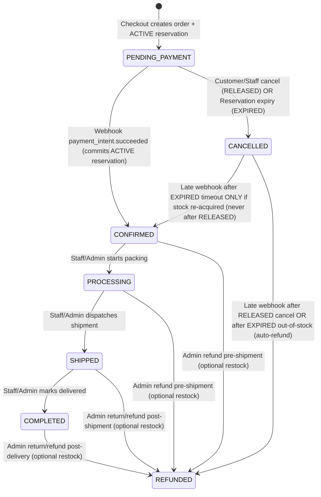

# 03 — Workflows, Inventory Concurrency, State Machines & Security

---

## 1. Authentication, Sessions, CSRF & RBAC Design

### 1.1 Password, Session & Cookie Cryptography
* **Password Hashing & Constant-Time Login**: `Argon2id` (`argon2-cffi` / `pwdlib`, minimum memory 64 MiB, time cost 3, parallelism 1). Password length `10..128` chars. On `POST /api/v1/auth/login`, if no user matches the email, run a dummy `Argon2id` verification to mitigate timing-based account enumeration; check `users.is_active` strictly *after* password verification succeeds.
* **Session Token**: 256-bit cryptographically random token (`secrets.token_urlsafe(32)`). Stored in the browser as an **HTTP-only cookie** `ecom_session` (`Path=/`, `HttpOnly=true`, `SameSite=Lax`, `Secure=true` when `COOKIE_SECURE=true` in HTTPS). Only `SHA-256(token)` is persisted in `auth_sessions.token_hash`. Default `SESSION_TTL_HOURS = 168` (7 days).
* **Live Per-Request Revalidation**: Every authenticated request joins `auth_sessions` with `users`, verifies `revoked_at IS NULL AND expires_at > now()`, and uses live `users.is_active` and `users.role` (rejecting suspended users with `403 AUTH_ACCOUNT_DISABLED` and revoking their session).
* **Dual-Auth Fail-Closed Rule**: On dual-auth routes (`/cart*`, `/checkout/orders`), if an `ecom_session` cookie is sent by the client but is invalid, expired, or revoked, the API **fails closed** with `401 AUTH_SESSION_EXPIRED` and clears `ecom_session` rather than silently downgrading to guest mode.
* **No `localStorage` Secrets**: Auth session tokens, CSRF secrets, and guest order tokens must never be persisted in `localStorage` or `sessionStorage`.
* **Guest Cart Cookie**: `ecom_guest_cart` (`HttpOnly=true`, `SameSite=Lax`, `Path=/`, `Secure` when HTTPS, 30-day TTL). Only `SHA-256(guest_token)` is stored in `carts.guest_token_hash`.
* **Guest Order Receipt Token (Bounded Cookie + HMAC Derivation)**: For anonymous checkouts (`user_id IS NULL`), the guest receipt token is derived deterministically via `HMAC-SHA256(GUEST_ORDER_HMAC_SECRET, f"{order.id}:{order.order_number}:{order.guest_token_version}")` with `guest_access_expires_at = placed_at + 30 days`.
  * Returned once in `POST /checkout/orders` JSON (and deterministically reproducible on idempotent `200 OK` replay without storing plaintext tokens in PostgreSQL).
  * Delivered to browsers via a **single** bounded HTTP-only cookie `ecom_guest_orders` (`HttpOnly=true`, `SameSite=Lax`, `Path=/api/v1`, `Secure` when HTTPS, `Max-Age=2592000`, holding at most the 5 most recent `order_number:token` pairs) and optionally accepted via `X-Guest-Order-Token` header.

### 1.2 CSRF & Origin Protection
* **Deterministic Per-Session CSRF Token**: Derived via `HMAC-SHA256(CSRF_HMAC_SECRET, f"{auth_sessions.id}:{auth_sessions.csrf_version}")` (recomputable on `POST /auth/login`, `POST /auth/register`, and `GET /auth/me` without storing plaintext secrets in PostgreSQL). Sent in `ecom_csrf` cookie (`HttpOnly=false`, `SameSite=Lax`, `Path=/`, `Secure` when HTTPS) and returned in auth responses.
* **Login / Register Session Hygiene**: `POST /auth/login` and `POST /auth/register` revoke any prior `ecom_session` present on the request and always mint a fresh `auth_sessions.id`.
* **Mandatory Origin + CSRF Enforcement**:
  1. **Origin / Referer Check**: On all state-changing routes (`POST`, `PATCH`, `PUT`, `DELETE`) except HMAC-authenticated webhooks (`/api/v1/webhooks/payments/{provider}`), if `Origin` or `Referer` is present, its scheme/host/port **must** match `ALLOWED_ORIGINS`; `Origin: null` is always rejected (`403 CSRF_INVALID`). Whenever a browser request carries `Cookie` or `Sec-Fetch-Site`, missing both `Origin` and `Referer` (or `Sec-Fetch-Site: cross-site`) is rejected (`403 CSRF_INVALID`).
  2. **Header CSRF Check**: All state-changing endpoints carrying `ecom_session` (except `login`, `register`, and webhooks) require `X-CSRF-Token` verified in constant time (`hmac.compare_digest`) against the session's derived HMAC token. Cookie-authenticated guest mutations (`ecom_guest_cart` / `ecom_guest_orders`) rely on `SameSite=Lax` + strict `Origin`/`Referer` enforcement (and may additionally require `ecom_csrf` if issued on `GET /cart`).

### 1.3 RBAC Permission Matrix

| Capability | `anonymous` | `customer` | `staff` | `admin` |
| :--- | :---: | :---: | :---: | :---: |
| Browse active categories & products (`GET /categories`, `/products`) | Yes | Yes | Yes | Yes |
| Manage own active cart (`GET/POST/PATCH/DELETE /cart`) | Yes (cookie) | Yes | Yes | Yes |
| Merge guest cart on login (`POST /cart/merge`) | No | Yes | Yes | Yes |
| Place checkout order (`POST /checkout/orders`) | Yes (guest) | Yes | Yes | Yes |
| List own orders (`GET /orders`) | No | Own only | Own only | Own only |
| Read/Cancel unpaid own order (`/orders/{order_number}`) | Valid guest token only | Own only | Own only *(use `/admin/orders/*`)* | Own only *(use `/admin/orders/*`)* |
| Manage products, categories, variants, stock adjustments (`/admin/*`) | No | No | Yes | Yes |
| View all orders, cancel unpaid orders, advance fulfillment (`/admin/orders/*`) | No | No | Yes | Yes |
| View sales analytics (`/admin/analytics/*`) | No | No | Yes | Yes |
| Issue payment refunds (`/admin/orders/*/refund`) | No | No | No | **Yes** |
| Manage user roles/status & read audit logs (`/admin/users*`, `/admin/audit-logs`) | No | No | No | **Yes** |

*Note*: Storefront endpoints `/api/v1/orders/{order_number}` and `/api/v1/orders/{order_number}/cancel` strictly serve the order owner (or valid guest order token). Staff and admin management always goes through `/api/v1/admin/orders/*` with RBAC + `audit_logs`.

---

## 2. Explicit State Machines & Transition Invariants

Payment confirmation and order fulfillment are **strictly separated**. Payment webhooks confirm payment (`PENDING_PAYMENT -> CONFIRMED` + `payment_status = PAID` + `fulfillment_status = ALLOCATED`); staff/admin fulfillment transitions `CONFIRMED -> PROCESSING -> SHIPPED -> COMPLETED`. Paid cancellations/returns go exclusively through `/api/v1/admin/orders/{order_number}/refund` (`orders.status = 'REFUNDED'`).

### 2.1 Order Lifecycle (`orders.status`)



### 2.2 Cross-Entity Synchronized State Transition Matrix

| Trigger / Action | Preconditions | `orders.status` | `orders.payment_status` | `orders.fulfillment_status` | `payment_intents.status` | `inventory_reservations.status` | Stock Impact (`inventory_stocks`) |
| :--- | :--- | :--- | :--- | :--- | :--- | :--- | :--- |
| **Checkout** (`POST /checkout/orders`) | Active cart non-empty; category/product/variant active; currency matches; stock available | `PENDING_PAYMENT` | `REQUIRES_PAYMENT` | `UNFULFILLED` | `REQUIRES_ACTION` | `ACTIVE` (`expires_at = +15m`) | `reserved += qty` (`RESERVE`) |
| **Payment Failed Webhook** (`payment_intent.failed`) | Order `PENDING_PAYMENT`; intent not `SUCCEEDED` | `PENDING_PAYMENT` | `FAILED` | `UNFULFILLED` | `FAILED` | Remains `ACTIVE` until expiry/cancel | No change |
| **Payment Succeeded (Normal)** (`payment_intent.succeeded`) | Order `PENDING_PAYMENT` (`payment_status != PAID`); reservation `ACTIVE`; amount/currency match | `CONFIRMED` (`paid_at = now()`) | `PAID` | `ALLOCATED` | `SUCCEEDED` | `ACTIVE -> COMMITTED` | `reserved -= qty; on_hand -= qty` (`COMMIT`) |
| **Cancel Unpaid Order** (Owner or Staff/Admin) | Order `PENDING_PAYMENT`; `payment_status IN ('REQUIRES_PAYMENT','FAILED')` | `CANCELLED` (`cancelled_at = now()`) | `CANCELLED` | `CANCELLED` | `CANCELLED` | `ACTIVE -> RELEASED` | `reserved -= qty` (`RELEASE`) |
| **Reservation Timeout Expiry** (Pre-checkout / Sweeper) | Order `PENDING_PAYMENT`; `expires_at < now()` | `CANCELLED` (`cancelled_at = now()`, `reason='RESERVATION_EXPIRED'`) | `CANCELLED` | `CANCELLED` | `CANCELLED` | `ACTIVE -> EXPIRED` | `reserved -= qty` (`RELEASE`) |
| **Late Webhook After Expiry — Stock Available** | `orders.status == 'CANCELLED'` AND `cancellation_reason == 'RESERVATION_EXPIRED'` (`EXPIRED`); SKUs `ACTIVE`; `on_hand - reserved >= qty` | `CONFIRMED` (`cancelled_at = NULL`, `paid_at = now()`) | `PAID` | `ALLOCATED` | `SUCCEEDED` | `EXPIRED -> COMMITTED` | `on_hand -= qty` (`delta_reserved = 0`, `COMMIT`) |
| **Late Webhook After Expiry — Out of Stock** | `orders.status == 'CANCELLED'` AND `EXPIRED`; insufficient stock or inactive SKU | `REFUNDED` (`paid_at = now()`) | `REFUNDED` | `CANCELLED` | `REFUNDED` | Remains `EXPIRED` | None (`PAYMENT_SUCCEEDED_OUT_OF_STOCK` + refund) |
| **Late Webhook After Explicit Cancel** | `orders.status == 'CANCELLED'` AND reservations `RELEASED` | `REFUNDED` (`paid_at = now()`) | `REFUNDED` | `CANCELLED` | `REFUNDED` | Remains `RELEASED` | None (`PAYMENT_SUCCEEDED_AFTER_CANCEL` + refund) |
| **Duplicate Success on Already-Paid Order** | `orders.payment_status == 'PAID'` (e.g., two intents succeeded) | Unchanged | `PAID` | Unchanged | New intent `-> REFUNDED` | Unchanged (`COMMITTED`) | None (`DUPLICATE_PAYMENT_REFUNDED` + refund) |
| **Start Processing** (`/admin/orders/{id}/fulfill`, `START_PROCESSING`) | `orders.status == 'CONFIRMED'` and `payment_status == 'PAID'` | `PROCESSING` | `PAID` | `ALLOCATED` | `SUCCEEDED` | `COMMITTED` | None |
| **Mark Shipped** (`/admin/orders/{id}/fulfill`, `SHIP`) | `orders.status IN ('CONFIRMED','PROCESSING')` and `payment_status == 'PAID'` | `SHIPPED` (`shipped_at = now()`) | `PAID` | `SHIPPED` | `SUCCEEDED` | `COMMITTED` | None |
| **Mark Completed** (`/admin/orders/{id}/fulfill`, `COMPLETE`) | `orders.status == 'SHIPPED'` and `payment_status == 'PAID'` | `COMPLETED` (`completed_at = now()`) | `PAID` | `DELIVERED` | `SUCCEEDED` | `COMMITTED` | None |
| **Admin Refund** (`/admin/orders/{id}/refund`) | `payment_status == 'PAID'` and `status IN ('CONFIRMED','PROCESSING','SHIPPED','COMPLETED')` | `REFUNDED` | `REFUNDED` | `RETURNED` (if `SHIPPED`/`COMPLETED`) else `CANCELLED` | `REFUNDED` | `COMMITTED` | If `restock=true`: `on_hand += qty` (`RETURN_RESTOCK`) |

---

## 3. End-to-End Checkout & Payment Sequence

```mermaid
sequenceDiagram
    autonumber
    actor Customer
    participant Web as Next.js Storefront
    participant API as FastAPI (orders/inventory/payments)
    participant DB as PostgreSQL

    Customer->>Web: Click "Place Order" (Idempotency-Key = uuid)
    Web->>API: POST /api/v1/checkout/orders (Idempotency-Key, addresses)
    API->>DB: Pre-step: expire overdue multi-line orders touching cart variants (orders SKIP LOCKED -> sorted stocks)
    API->>DB: BEGIN TRANSACTION + pg_advisory_xact_lock(scoped_idempotency_key)
    API->>DB: Check orders.idempotency_key (return 200 if exact fingerprint match, 409 on mismatch)
    API->>DB: SELECT inventory_stocks WHERE variant_id IN (...) ORDER BY variant_id ASC FOR UPDATE
    API->>API: Verify category/product/variant active, currency match, on_hand - reserved >= qty
    API->>API: Compute subtotal, shipping, tax, total from product_variants.price_cents
    API->>DB: INSERT orders (PENDING_PAYMENT), order_items, order_events
    API->>DB: UPDATE inventory_stocks SET reserved += qty; INSERT reservation (ACTIVE) & ledger (RESERVE)
    API->>DB: UPDATE carts SET status = 'CONVERTED'; INSERT payment_intents (REQUIRES_ACTION)
    API->>DB: COMMIT
    API-->>Web: 201 Created {order, payment_intent, guest_access_token?}

    Customer->>Web: Confirm Sandbox Payment
    Web->>API: POST /api/v1/payments/sandbox/{provider_intent_id}/simulate
    API->>API: Lock payment_intent FOR UPDATE; invoke verified webhook processor in-process
    API->>API: Verify provider=='sandbox_simpay', body<=64KiB, |now-ts|<=300s, HMAC-SHA256
    API->>DB: BEGIN TRANSACTION
    API->>DB: INSERT INTO payment_webhook_events ... ON CONFLICT DO NOTHING
    alt Duplicate provider_event_id
        API->>DB: ROLLBACK / no-op
        API-->>Web: 200 OK {status: "IGNORED_DUPLICATE"}
    else First delivery
        API->>DB: Lock payment_intent -> order -> inventory_stocks (ORDER BY variant_id ASC FOR UPDATE)
        API->>DB: Apply state matrix (commit reservation, update order/intent, ledger COMMIT)
        API->>DB: Mark payment_webhook_events.status = 'PROCESSED'; COMMIT
        API-->>Web: 200 OK {webhook_status: "PROCESSED", order_status: "CONFIRMED"}
    end
```

---

## 4. Inventory Concurrency & Deadlock-Free Lock Hierarchy

To guarantee zero overselling and zero circular deadlocks across `checkout`, `cancel`, `webhook`, `refund`, `admin adjust`, and `sweeper`:

1. **Universal Lock Hierarchy**: Every write transaction **must** acquire locks strictly in this order:
   1. `payment_intents` (if involved)
   2. `orders` (if involved)
   3. `inventory_stocks` — **always** sorted by `variant_id ASC` (`ORDER BY variant_id ASC FOR UPDATE`).
   No transaction may acquire an `orders` lock while already holding `inventory_stocks` locks.
2. **Atomic Full-Order Expiration (No Orphaned Multi-Line Reservations)**:
   * Because a cancelled/expired order must release **all** its line items together, expiration never modifies an order piecemeal from a single-variant lock.
   * Before checkout starts its main stock lock (or in a lightweight background sweep every 60s), identify candidate expired `order_id`s (`SELECT DISTINCT order_id FROM inventory_reservations WHERE variant_id = ANY(:cart_variant_ids) AND status = 'ACTIVE' AND expires_at < now()`).
   * For each candidate `order_id` in a short transaction: lock `orders WHERE id = :oid AND status = 'PENDING_PAYMENT' FOR UPDATE SKIP LOCKED`, load **all** its `ACTIVE` reservations, sort **all** of that order's `variant_id`s ascending, lock `inventory_stocks ORDER BY variant_id ASC FOR UPDATE`, release `reserved -= qty` across every line, mark all reservations `EXPIRED`, transition the order to `CANCELLED` (`cancellation_reason = 'RESERVATION_EXPIRED'`), and record `inventory_ledger_entries` (`RELEASE`).
3. **Checkout Stock Lock & DB Safety Net**:
   * Lock all `inventory_stocks` rows for the active cart sorted by `variant_id ASC FOR UPDATE`.
   * Check `stock.on_hand - stock.reserved >= item.quantity` for every item; on failure, rollback immediately and return `409 INSUFFICIENT_STOCK`.
   * PostgreSQL checks `CHECK (on_hand >= 0)`, `CHECK (reserved >= 0)`, `CHECK (reserved <= on_hand)`, and `CHECK (reserved_after <= on_hand_after)` provide a hard database backstop.

---

## 5. Security Threat Model & Mitigations

| Threat | Attack Vector | Mitigation in Design |
| :--- | :--- | :--- |
| **Price / Total Tampering** | Client sends modified price, negative quantity, or forged discount | Checkout schema accepts no prices, discounts, or totals; server computes `unit_price_cents` from `product_variants` and enforces deterministic shipping/tax + DB `CHECK` constraints (`quantity > 0`, `discount_cents <= subtotal_cents`, `total_cents = ...`). |
| **Concurrent Overselling & Deadlocks** | Parallel checkouts compete for last SKU unit or multi-SKU carts | Uniform lock order (`payment_intents` -> `orders` -> `inventory_stocks ORDER BY variant_id ASC FOR UPDATE`) + atomic full-order expiry + DB `CHECK (reserved <= on_hand)`. |
| **Webhook Forgery, Replay & Pre-Poisoning** | Forged or replayed webhook, or pre-inserting `provider_event_id` | Strict verification order: allowlisted `{provider}` -> body size `<= 64 KiB` -> `abs(now - ts) <= 300s` -> constant-time HMAC-SHA256 over `b"{ts}." + raw_body` -> Pydantic validation -> `INSERT ... ON CONFLICT DO NOTHING`. |
| **IDOR on Orders & Carts** | Customer/guest reads or cancels another order/cart | Storefront `/orders/*` and `/cart*` filter strictly by `current_user.id` or validated HMAC guest token (`ecom_guest_orders` / `ecom_guest_cart`); staff/admin access lives strictly under `/api/v1/admin/*`. |
| **CSRF & Login CSRF** | Cross-site form posts or sibling-subdomain login forgery | `HttpOnly` + `SameSite=Lax` cookies, HMAC-derived `X-CSRF-Token` on authenticated mutations, strict `Origin`/`Referer` validation rejecting `Origin: null` and missing origin on browser requests, and session rotation on login/register. |
| **XSS / Unsafe URLs** | Stored XSS via image URLs or stolen tokens in `localStorage` | No tokens in `localStorage`; React output escaping; `product_images.url` restricted strictly to `https://` or relative `/assets/` paths; CSP headers on Next.js. |
| **Inventory-Hoarding & Auth DoS** | Bot creates hundreds of guest checkouts or brute-forces login | Sliding-window rate limiting on `/auth/login`, `/auth/register`, `/checkout/orders`, `/cart/items`, and guest `/orders/{order_number}` lookups; max 3 active `PENDING_PAYMENT` orders per guest/IP window. |
| **Privilege Escalation & Stale Sessions** | Self-setting `role`, or disabled/demoted user reusing cookie | `register` and `PATCH /me` reject `role`; live `users.is_active` and `users.role` checked every request; role/status changes revoke all target `auth_sessions`; `CANNOT_DEMOTE_SELF` and `CANNOT_REMOVE_LAST_ADMIN` guards. |
| **Production Misconfiguration / Sandbox Leak** | `PAYMENT_SANDBOX_MODE=true` or weak secret deployed to prod | Fail-closed startup validation in `core/config.py`: refuses boot if `ENVIRONMENT == 'production'` and any of `PAYMENT_SANDBOX_MODE=true`, `COOKIE_SECURE=false`, wildcard `ALLOWED_ORIGINS`, or secret `< 32` chars. |
| **Search Wildcard Injection & Audit Gaps** | Unescaped `%`/`_` in `ILIKE` search or unaudited admin edits | Escape `\`, `%`, `_` and cap `q <= 100` chars on all search queries; mandatory secret-redacted `audit_logs` write for all `/api/v1/admin/*` mutations. |
