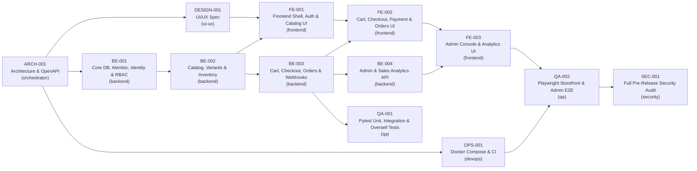

# 04 — Architectural Decision Records (ADRs) & Implementation Roadmap

---

## 1. Architectural Decision Records

### ADR-001: Modular Monolith over Microservices
* **Context**: The application needs strict transactional consistency across catalog pricing, inventory stock reservation, cart conversion, and order creation, while maintaining clear engineering ownership (`frontend`, `backend`, `devops`, `qa`, `security`, `ui-ux`).
* **Decision**: Implement a single Python/FastAPI backend organized into 8 strict domain modules (`backend/app/modules/*`) backed by a single PostgreSQL 16 database.
* **Consequences**: Enables single-DB ACID transactions (`SELECT ... FOR UPDATE`), zero distributed saga complexity, simpler Docker Compose deployment (`web`, `api`, `db`), and fast local/CI testing. Cross-module calls must use narrow service interfaces rather than directly reaching into another module's internal ORM queries.

### ADR-002: Server-Backed HTTP-Only Session Cookies over `localStorage` JWTs
* **Context**: E-commerce storefronts handle customer PII, orders, and admin/staff inventory/refund privileges. Storing long-lived bearer tokens in `localStorage` exposes accounts to XSS theft, and stateless JWTs cannot be immediately revoked on logout or account suspension.
* **Decision**: Use opaque 256-bit random session tokens in an `HttpOnly`, `SameSite=Lax` cookie (`ecom_session`), backed by `auth_sessions` in PostgreSQL (storing SHA-256 token hashes), paired with a session-bound `X-CSRF-Token` header for all authenticated mutations.
* **Consequences**: Immediate session revocation on logout, password change, or `is_active=false`; immune to `localStorage` XSS token exfiltration. Adds one indexed primary/unique DB lookup per authenticated request (negligible overhead at target scale).

### ADR-003: PostgreSQL Row-Level Locking (`FOR UPDATE`) over Redis Distributed Locks
* **Context**: Preventing overselling when concurrent shoppers purchase the last unit of a SKU is a primary correctness requirement, and baseline rules exclude Redis/Celery unless strictly necessary.
* **Decision**: Lock `inventory_stocks` rows in ascending `variant_id` order (`ORDER BY variant_id ASC FOR UPDATE`) under a uniform lock hierarchy (`payment_intents -> orders -> inventory_stocks`) inside PostgreSQL transactions, enforced by `CHECK (reserved <= on_hand)` constraints and 15-minute `inventory_reservations` with atomic full-order expiration reclaim.
* **Consequences**: Strongest possible consistency guarantee without introducing Redis or distributed lock drift. Assumes single primary PostgreSQL instance; lock hold times stay sub-10ms by performing zero external network calls while holding row locks.

### ADR-004: Explicit Separation of Payment Confirmation (`CONFIRMED`) and Fulfillment (`PROCESSING`/`SHIPPED`/`COMPLETED`)
* **Context**: Real-world payment gateways confirm payment asynchronously via webhooks, whereas physical warehouse fulfillment happens afterward via staff actions.
* **Decision**: Track orthogonal `orders.status`, `orders.payment_status`, and `orders.fulfillment_status` columns. Only verified idempotent webhooks move `PENDING_PAYMENT -> CONFIRMED` (`PAID` + `ALLOCATED` + stock commit), while staff/admin endpoints advance `CONFIRMED -> PROCESSING -> SHIPPED -> COMPLETED`.
* **Consequences**: Eliminates ambiguous order states, ensures analytics only recognize genuinely paid orders, and cleanly models pre-shipment vs. post-shipment refunds/cancellations.

### ADR-005: Sandbox-Only Payment Provider Adapter Behind Signed Webhooks
* **Context**: Application requires full checkout, payment failure/retry, webhook deduplication, and refund flows without real card collection or PCI scope.
* **Decision**: Implement a sandbox provider interface (`sandbox_simpay`) with `payment_intents`, a sandbox simulation trigger (`PAYMENT_SANDBOX_MODE=true`), and a production-patterned HMAC-SHA256 webhook receiver (`POST /api/v1/webhooks/payments/{provider}`) backed by `payment_webhook_events`.
* **Consequences**: Zero PAN/CVV exposure; webhook signature, replay, and idempotency logic are fully exercised by `pytest` and Playwright E2E tests and can later accommodate a real PSP adapter cleanly.

### ADR-006: Live SQL Aggregations over Separate Analytics Pipelines/Stores
* **Context**: Staff/admin users require accurate sales revenue, time-series, top SKUs, and inventory health metrics.
* **Decision**: Compute analytics directly from persisted `orders`, `order_items`, and `inventory_stocks` via indexed SQL queries in `analytics`, rather than adding Kafka, ClickHouse, or pre-aggregated background ETL jobs.
* **Consequences**: Guaranteed consistency with persisted financial/order data (zero ETL lag or reconciliation mismatch). Requires bounded query windows (`<= 366 days`) and covering composite indexes on `orders(paid_at, status, payment_status)`.

---

## 2. Trade-offs & Unresolved / Deferred Decisions

| Item | Baseline Decision | Trade-off / Future Trigger |
| :--- | :--- | :--- |
| **Single Currency (`USD`)** | All prices and orders default to `USD` minor units (`*_cents`). | Multi-currency storefronts require exchange rate snapshots and currency-matched carts/orders; deferred unless requested. |
| **Shipping & Tax Calculation** | Deterministic server-side flat-rate / threshold shipping (e.g., free over `$100`, otherwise `$10`) and configurable flat tax rate (`TAX_RATE_BPS`) stored in order totals. | Complex regional tax nexus (Avalara/TaxJar) or live carrier rates would require external paid API approval per `AGENTS.md`. |
| **Reservation Expiration Sweep** | Lazy reclamation on checkout/availability reads + optional lightweight periodic cleanup task in FastAPI lifespan. | High-volume flash sales with thousands of abandoned checkouts per minute would justify a dedicated job worker later. |
| **Rate-Limiting Storage** | Sliding-window in-process memory limiter for single-API instance (or Nginx/reverse proxy rate limit). | Scaling horizontally to multiple `api` replicas would justify a shared store (e.g., PostgreSQL rate bucket or Redis) for auth throttling. |
| **Product Image Hosting** | Product images store validated external `https://` URLs or local static paths (`/assets/...`). | Binary media upload to S3/GCS is deferred until object storage requirements are confirmed. |

---

## 3. Implementation Milestones & Dependency Graph

Per `AGENTS.md` and `docs/TEAM_OPERATIONS.md`:
* At most **two** implementation workers may run concurrently **only** after `ARCH-001` (and `DESIGN-001` for UI) is verified and writable paths do not overlap (`backend/**` vs `frontend/**` vs `infra/**`).
* `qa` owns `backend/tests/**`, `frontend/tests/**`, `frontend/e2e/**`, `docs/qa/**`; `security` remains read-only.

### Proposed Task Sequence (`docs/TASKS.md` Roadmap)

| Task ID | Deliverable | Owner | Allowed Writable Paths | Dependencies | Acceptance Evidence |
| :--- | :--- | :--- | :--- | :--- | :--- |
| `ARCH-001` | Architecture & OpenAPI contracts | `orchestrator` | `docs/architecture/**`, `docs/api/**` | none | Security-reviewed docs & contract consistency |
| `DESIGN-001` | Storefront & admin UX spec + tokens | `ui-ux` | `docs/design/**` | `ARCH-001` | Responsive UX journeys, states, a11y spec |
| `OPS-001` | Docker Compose, env templates, CI skeleton | `devops` | `infra/**`, `.github/workflows/**`, `compose.yaml`, `Dockerfile*`, `.env.example` | `ARCH-001` | `docker compose config` & CI lint checks pass |
| `BE-001` | FastAPI core, SQLAlchemy 2, Alembic initial schema, Identity/CSRF/RBAC | `backend` | `backend/**` excl. `backend/tests/**` | `ARCH-001` | `alembic upgrade head`, app boot, auth/CSRF smoke check |
| `BE-002` | Catalog, categories, variants, stock & ledger services/routes | `backend` | `backend/**` excl. `backend/tests/**` | `BE-001` | Typecheck/lint + seed & stock constraint check |
| `BE-003` | Cart, idempotent checkout, `FOR UPDATE` reservation, orders, sandbox payments & webhooks | `backend` | `backend/**` excl. `backend/tests/**` | `BE-002` | Typecheck/lint + OpenAPI schema parity check |
| `BE-004` | Admin management (users/audit/fulfillment/refund) & analytics SQL endpoints | `backend` | `backend/**` excl. `backend/tests/**` | `BE-003` | Typecheck/lint + OpenAPI parity check |
| `FE-001` | Next.js shell, typed API client, auth UI, storefront catalog/product detail | `frontend` | `frontend/**` excl. `tests/`, `e2e/` | `DESIGN-001`, `BE-002` | `tsc --noEmit`, `eslint`, `next build` |
| `FE-002` | Cart drawer/page, checkout, sandbox payment confirmation, customer order history | `frontend` | `frontend/**` excl. `tests/`, `e2e/` | `FE-001`, `BE-003` | `tsc --noEmit`, `eslint`, `next build` |
| `FE-003` | Admin dashboard, catalog/inventory/orders/users/analytics pages | `frontend` | `frontend/**` excl. `tests/`, `e2e/` | `FE-002`, `BE-004` | `tsc --noEmit`, `eslint`, `next build` |
| `QA-001` | Backend pytest suite (auth, RBAC, price tamper, concurrent oversell race, webhook replay) | `qa` | `backend/tests/**`, `docs/qa/**` | `BE-004` | `pytest` full pass report + race test evidence |
| `QA-002` | Frontend & Playwright E2E suite (browse -> cart -> checkout -> webhook -> admin fulfill) | `qa` | `frontend/tests/**`, `frontend/e2e/**`, `docs/qa/**` | `FE-003`, `OPS-001` | Playwright pass report + browser verification |
| `SEC-001` | Scoped security review of auth, RBAC, checkout, webhooks, Docker/CI config | `security` | Read-only (`send_message`; Orchestrator records in `docs/security/**`) | `QA-001`, `QA-002` | Resolved high/critical findings before sign-off |
